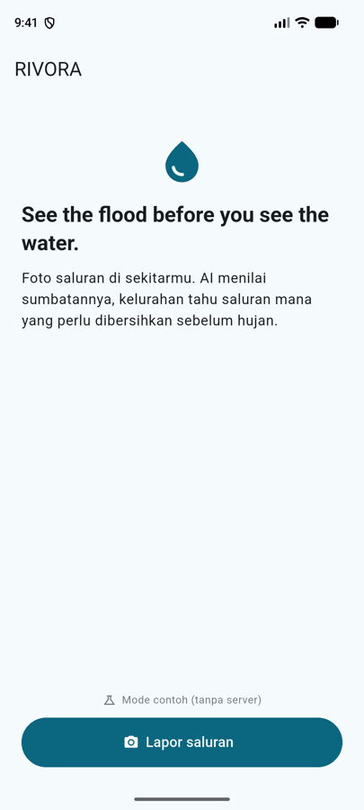
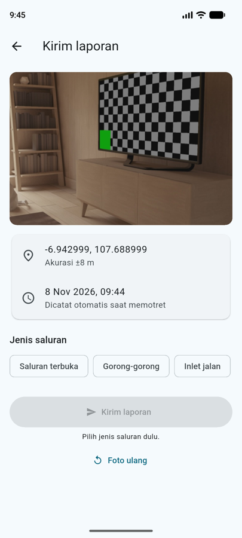
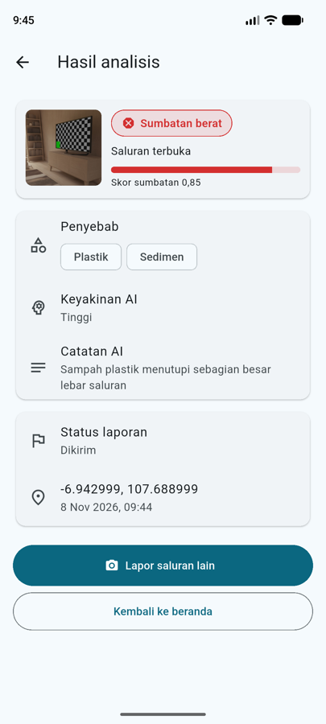
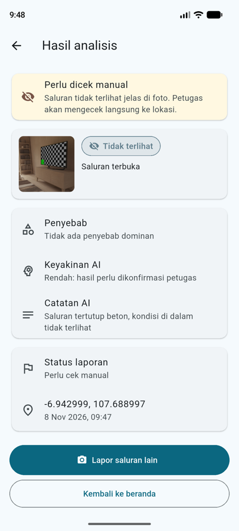

# 01 · Alur Lapor (jam 1–5)

**Tanggal:** 8 November 2026 · **Branch:** `feature/mobile`
**Acuan proposal:** 3.2 langkah 1 (Lapor), Tabel 3 (Lapor foto + GPS, Analisis sumbatan AI), Tabel 8 (mitigasi laporan palsu, keyakinan AI), Lampiran C (format JSON AI), Tabel 13 (peran mobile)

## Yang dibuat

Alur lengkap dari beranda sampai hasil AI:

```
Beranda ──► Izin lokasi ──► Kamera in-app ──► Konfirmasi laporan ──► Hasil analisis AI
 "Lapor       (sekali)       jepret → GPS      pilih jenis saluran     kelas, skor, penyebab,
 saluran"                    + waktu otomatis   → Kirim                 keyakinan, status
```

| Layar | File | Isi |
|---|---|---|
| Beranda | `screens/home_screen.dart` | Tagline, tombol **Lapor saluran**, info mode (contoh / server) |
| Kamera | `screens/camera_screen.dart` | Kamera belakang, tombol jepret. **Tidak ada tombol galeri** |
| Konfirmasi | `screens/report_form_screen.dart` | Foto, koordinat + akurasi, waktu, pilihan jenis saluran, Kirim / Foto ulang |
| Hasil | `screens/result_screen.dart` | Badge kelas sumbatan berwarna, skor 0–1, penyebab, **keyakinan AI**, catatan, status laporan |

## Kesesuaian dengan proposal

| Proposal | Implementasi |
|---|---|
| Foto langsung dari kamera, bukan galeri (3.2) | Plugin `camera`, tanpa `image_picker`/galeri |
| GPS dan waktu tercatat otomatis (3.2) | `capturedAt` diambil saat jepret, posisi dari `geolocator` setelah jepret. Pengguna tidak bisa mengetik lokasi |
| Pilih jenis saluran: terbuka, gorong-gorong, inlet jalan (3.2) | `ChoiceChip`, wajib dipilih sebelum Kirim |
| Kelas bersih/ringan/sedang/berat + "tidak terlihat" (3.2) | `KelasSumbatan`, warna hijau → merah, abu-abu untuk tidak terlihat |
| "Tidak terlihat" → cek manual (3.2, Tabel 8) | Banner "Perlu dicek manual" + status `cek_manual` |
| Keyakinan AI selalu ditampilkan (Tabel 8) | Selalu tampil; keyakinan rendah diberi keterangan "perlu dikonfirmasi petugas" |
| Mencegah laporan palsu (Tabel 3, Tabel 8) | Kamera saja + tolak lokasi palsu (`Position.isMocked`) |
| Format JSON AI (Lampiran C) | `AiResult.fromJson` membaca persis field Lampiran C |

## Keputusan teknis

- **Mode contoh (`MockApiClient`)**: tanpa `API_URL`, app memakai hasil AI contoh bergiliran (berat → sedang → tidak terlihat → bersih). Mobile tidak perlu menunggu backend, dan bisa jadi cadangan demo.
- **Izin lokasi diminta di beranda**, sebelum kamera dibuka. Kalau diminta saat kamera aktif, dialog izin membuat kamera tertutup lalu dibuka ulang.
- **GPS dipanaskan** begitu kamera siap, supaya saat jepret posisi didapat lebih cepat. Batas tunggu 15 detik, lalu memakai posisi terakhir yang diketahui.
- **GPS lewat `LocationManager` Android** (`forceLocationManager: true`), bukan Google Play Services. Dengan Play Services, setiap pengambilan posisi memunculkan dialog "Location Accuracy" dari Google; kalau ditolak, posisi gagal didapat. Ditemukan saat uji emulator.
- **Semua error lokasi diubah jadi pesan yang jelas** (GPS mati, izin ditolak, gagal baca). Sebelumnya error dari geolocator tidak tertangkap dan pengguna kembali ke kamera tanpa keterangan.
- **Chip jenis saluran tanpa centang** supaya lebarnya tetap dan tombol Kirim tidak bergeser saat chip dipilih.
- **Waktu dikirim dalam UTC** (`2026-11-08T02:30:00.000Z`) supaya backend tidak salah zona waktu.
- **Kelas AI yang tidak dikenal** dianggap "tidak terlihat" (masuk cek manual), bukan "bersih".
- **Tanpa state management library**: `StatefulWidget` + service global (`api`, `locationService`) supaya cepat dikerjakan dalam 12 jam.
- **Android**: izin `CAMERA`, `ACCESS_FINE_LOCATION`, `ACCESS_COARSE_LOCATION`, `INTERNET`. `usesCleartextTraffic="true"` sementara supaya bisa ke backend `http://` lokal; hapus setelah backend https.
- **Gradle wrapper memakai distribusi `-bin`** (bukan `-all` bawaan template). Unduhan `-all` (±235 MB) macet di koneksi lambat; `-bin` lebih kecil dan cukup untuk build dari CLI.

## Yang mobile harapkan dari backend (perlu disepakati dengan B)

`docs/API.md` milik B. Ini usulan bentuk respons yang sudah dibaca mobile:

**Request** `POST /reports` (multipart/form-data)

| Field | Contoh |
|---|---|
| `foto` | file JPEG (`image/jpeg`) |
| `lat` | `-6.940123` |
| `lng` | `107.690456` |
| `captured_at` | `2026-11-08T02:30:00.000Z` |
| `jenis_saluran` | `terbuka` · `gorong_gorong` · `inlet_jalan` |

**Respons 200/201**

```json
{
  "id": 42,
  "status": "dikirim",
  "jenis_saluran": "terbuka",
  "lat": -6.940123,
  "lng": 107.690456,
  "captured_at": "2026-11-08T02:30:00.000Z",
  "foto_url": "https://…/laporan/42.jpg",
  "ai": {
    "jenis_saluran": "terbuka",
    "saluran_terlihat": true,
    "kelas_sumbatan": "berat",
    "skor_sumbatan": 0.85,
    "penyebab": ["plastik", "sedimen"],
    "keyakinan": "tinggi",
    "catatan": "Sampah plastik menutupi sebagian besar lebar saluran"
  }
}
```

**Respons gagal:** status 4xx/5xx dengan `{ "error": "pesan" }`. Pesan ditampilkan apa adanya ke pengguna.

`id` boleh angka atau string. `foto_url` boleh kosong.

## Hasil uji

**Otomatis:** `flutter analyze` bersih, `flutter test` 5/5 lulus (parsing Lampiran C, cek manual, kelas tak dikenal, id angka, giliran MockApiClient). `flutter build apk --debug` berhasil.

**Emulator Pixel 8 (Android, mode contoh, GPS diset ke -6.943, 107.689):**

| Langkah | Hasil |
|---|---|
| Lapor saluran → izin lokasi → izin kamera | Dialog izin lokasi muncul di beranda, izin kamera di layar kamera |
| Jepret | Koordinat, akurasi ±8 m, dan waktu terisi otomatis |
| Kirim sebelum pilih jenis | Tombol mati + petunjuk "Pilih jenis saluran dulu" |
| Laporan ke-1, 2, 3 | Berat (merah, 0,85) → sedang (oranye, 0,55) → tidak terlihat (banner cek manual, status "Perlu cek manual") |

Belum diuji: GPS dimatikan, izin ditolak permanen, dan kirim ke backend asli (backend belum ada).

| Beranda | Konfirmasi | Hasil: berat | Hasil: tidak terlihat |
|---|---|---|---|
|  |  |  |  |

Foto berasal dari kamera virtual emulator (ruangan contoh), bukan saluran asli.

## Cara tes

```bash
cd mobile
flutter test                 # 5 tes unit
flutter run                  # mode contoh
```

Skenario manual di HP/emulator:

1. Beranda → **Lapor saluran** → izinkan lokasi → izinkan kamera.
2. Jepret → layar konfirmasi menampilkan koordinat, akurasi, dan waktu.
3. Tombol Kirim mati sebelum jenis saluran dipilih.
4. Kirim 4 kali → hasil berurutan: berat, sedang, tidak terlihat (banner cek manual), bersih.
5. Matikan GPS → tekan Lapor saluran → muncul pesan + tombol **Pengaturan**.

## Belum dikerjakan

- Login (`POST /auth/login`) dan header `Authorization`. Ditambah kalau backend mewajibkan token.
- Riwayat/status laporan saya → tahap 02.
- Tab Tugas, notifikasi FCM, foto sesudah → tahap 02–03.
- Kompresi foto. Saat ini resolusi `high` (±1280×720), cukup kecil untuk diunggah.
