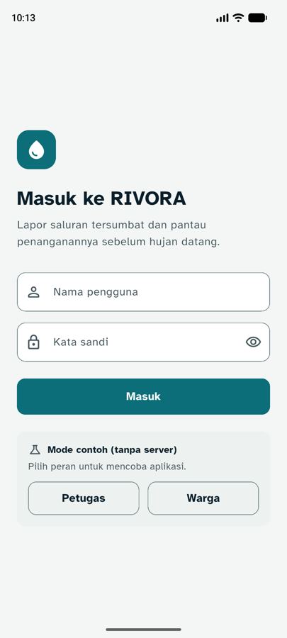
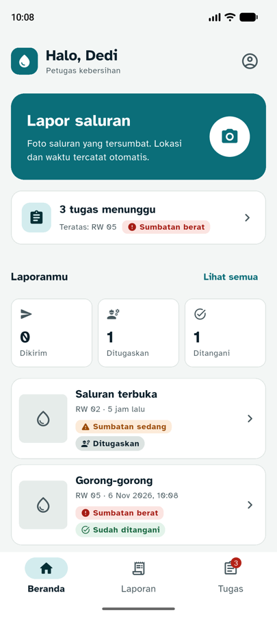
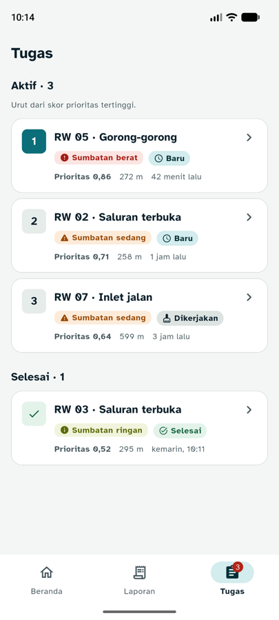
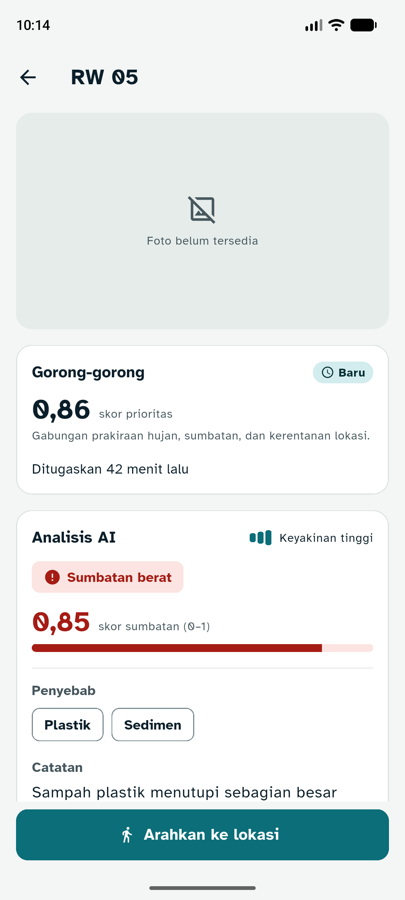
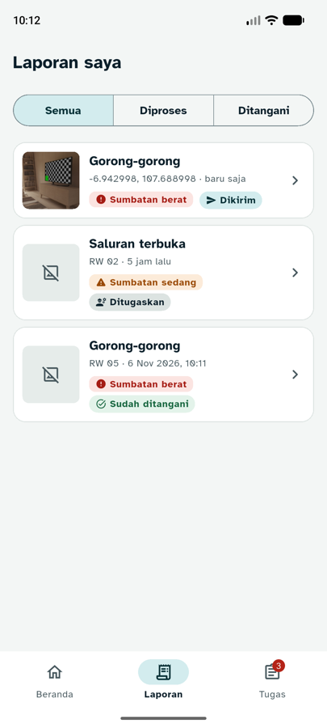
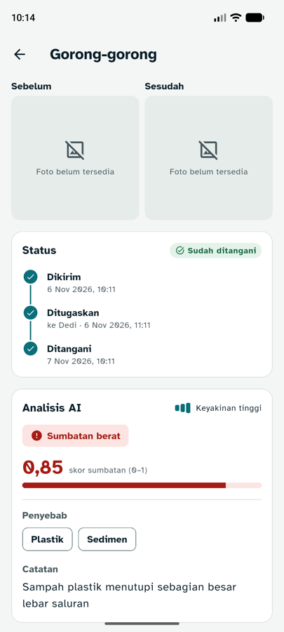
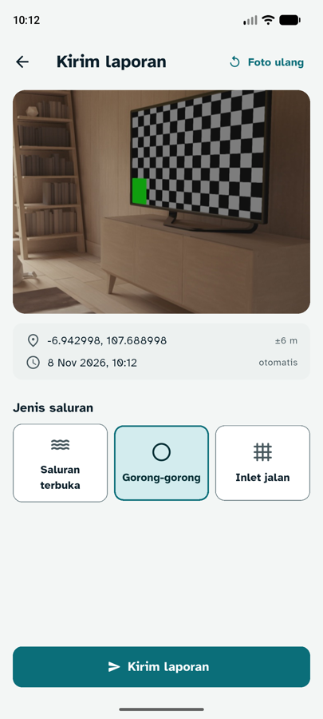
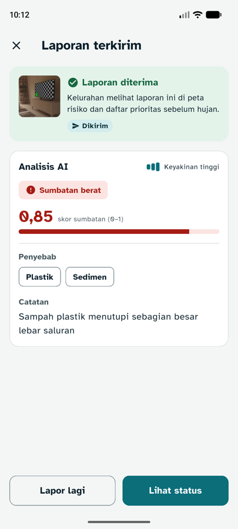
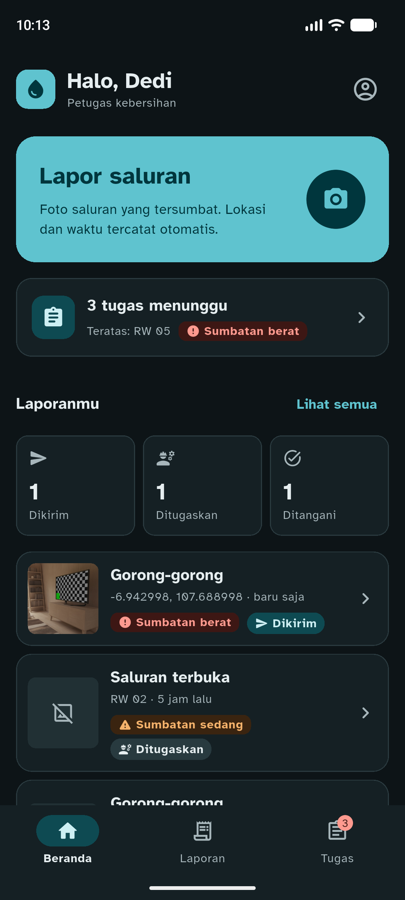
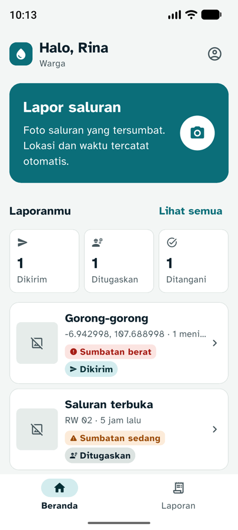

# 02 · Status Laporan, Tab Tugas, dan Design System (jam 5–8)

**Tanggal:** 8 November 2026 · **Branch:** `feature/mobile`
**Acuan proposal:** 3.2 langkah 3 (daftar diurutkan dari skor tertinggi, lurah menugaskan petugas), Tabel 3 (Penugasan dan notifikasi), Tabel 4 (warga melihat laporannya ditindaklanjuti dengan bukti), Tabel 8 (status "sudah ditangani" + foto dikirim kembali ke pelapor), Tabel 12 (autentikasi), Tabel 13 (peran mobile)

## Yang dibuat

1. **Design system** untuk seluruh app: token warna light/dark, font Atkinson Hyperlegible, komponen bersama. Detail: [00-design-system.md](00-design-system.md).
2. **Login** dengan peran (warga / petugas). Sesi disimpan di perangkat.
3. **Navigasi bawah:** Beranda, Laporan, Tugas (khusus petugas, dengan badge jumlah tugas aktif).
4. **Beranda baru:** sapaan + peran, kartu utama Lapor saluran, ringkasan tugas (petugas), statistik laporan, 3 laporan terbaru.
5. **Laporan saya:** daftar + filter Semua / Diproses / Ditangani, tarik untuk refresh.
6. **Detail laporan:** foto sebelum/sesudah, timeline Dikirim → Ditugaskan → Ditangani, hasil AI, lokasi + Buka di Maps.
7. **Tab Tugas:** urut prioritas tertinggi, nomor urut, jarak dari posisi petugas, status Baru / Dikerjakan / Selesai.
8. **Detail tugas:** skor prioritas, hasil AI, lokasi + jarak, tombol **Arahkan ke lokasi** (Google Maps, mode jalan kaki).
9. **Desain ulang layar tahap 01:** konfirmasi laporan (pilihan jenis saluran berupa 3 kartu berikon, tombol Kirim menempel di bawah) dan layar hasil (banner sukses / cek manual, kartu AI, tombol Lapor lagi / Lihat status).

## File baru dan berubah

| File | Isi |
|---|---|
| `lib/theme/app_theme.dart` | Token warna, `RivoraColors`, `buildRivoraTheme()` |
| `lib/models/session.dart` | Sesi login + label peran |
| `lib/models/task.dart` | Model tugas |
| `lib/models/report.dart` | + field timeline (`rw`, `ditugaskan_at`, `ditangani_at`, `petugas_nama`, `foto_sesudah_url`) |
| `lib/services/api_client.dart` | + `login`, `myReports`, `myTasks`, token Bearer, data contoh |
| `lib/services/session_store.dart` | Simpan/muat sesi (`shared_preferences`) |
| `lib/services/repositories.dart` | `ReportRepository`, `TaskRepository` |
| `lib/services/location_service.dart` | + `lastKnown()` untuk jarak tanpa menunggu GPS |
| `lib/screens/login_screen.dart` | Login |
| `lib/screens/app_shell.dart` | Navigasi bawah + `keluar()` |
| `lib/screens/home_screen.dart` | Beranda baru |
| `lib/screens/reports_screen.dart` | Laporan saya |
| `lib/screens/report_detail_screen.dart` | Detail + timeline |
| `lib/screens/tasks_screen.dart` | Daftar tugas |
| `lib/screens/task_detail_screen.dart` | Detail tugas |
| `lib/screens/lapor_flow.dart` | `mulaiLapor()` dipakai dari beberapa layar |
| `lib/screens/report_form_screen.dart`, `result_screen.dart` | Desain ulang |
| `lib/widgets/*` | Komponen bersama (lihat design system) |
| `lib/utils/format.dart` | + `formatRelatif`, `formatJarak` |
| `lib/utils/maps.dart` | Buka Google Maps |
| `assets/fonts/` | Atkinson Hyperlegible Regular + Bold + OFL |
| `test/tahap02_test.dart` | 8 tes baru |

Package baru: `shared_preferences` (sesi), `url_launcher` (Maps).

## Keputusan teknis

- **Peran menentukan tab.** Tab Tugas hanya untuk `role == 'petugas'`. Lurah memakai dasbor web, bukan app.
- **Sesi disimpan di perangkat** supaya tidak perlu login ulang setiap app dibuka saat demo. Respons 401 dari server otomatis mengeluarkan pengguna.
- **Laporan yang baru dikirim langsung masuk daftar** tanpa menunggu refresh, dan foto lokalnya dipakai sampai server mengirim `foto_url`.
- **Urutan tugas:** belum selesai di atas, lalu skor prioritas tertinggi (proposal 3.2 langkah 3). Diurutkan juga di app supaya tidak bergantung pada urutan dari server.
- **Jarak ke tugas** memakai posisi terakhir yang diketahui (`lastKnown`), jadi daftar langsung tampil tanpa menunggu GPS.
- **"Arahkan ke lokasi"** membuka Google Maps lewat URL `https`, jadi jalan walaupun Maps tidak terpasang (terbuka di browser).
- **Foto bukti sesudah** hanya ditulis "tersedia" kalau `foto_sesudah_url` benar-benar ada.

## Bug yang ditemukan dan diperbaiki saat uji emulator

| Gejala | Penyebab | Perbaikan |
|---|---|---|
| Statistik 0/0/0 dan "Tidak ada tugas aktif" padahal data ada | `_StatRow` dan `_TugasCard` adalah widget `const`, jadi tidak digambar ulang | Kedua widget mendengarkan repositorinya sendiri |
| Judul AppBar dan teks tombol kecil (14) | `base.textTheme` saat tema dibuat belum berisi ukuran huruf | Digabung dengan `Typography.englishLike2021` |
| Segmen filter terpilih berwarna navy | `secondaryContainer` belum diisi, jatuh ke `secondary` | Diisi teal muda, sama dengan pilihan lain |
| Logo login melebar penuh | Anak `ListView` diregangkan selebar layar | Dibungkus `Align` |
| Ikon "NEW" berbahasa Inggris di chip Baru | Ikon `fiber_new` | Diganti ikon jam |

## Usulan kontrak untuk backend (perlu disepakati dengan B)

`docs/API.md` milik B. Mobile sudah membaca bentuk di bawah ini.

### `POST /auth/login`

Request: `{ "username": "dedi", "password": "…" }`
Respons: `{ "token": "…", "role": "petugas", "nama": "Dedi" }`. `role`: `warga` | `petugas` | `lurah`. Gagal: 401 + `{ "error": "Nama pengguna atau kata sandi salah" }`.

Semua request berikutnya mengirim `Authorization: Bearer <token>`.

### `GET /reports?mine=1` (endpoint baru)

Array laporan milik pengguna yang login, terbaru dulu. Boleh `[...]` atau `{ "data": [...] }`. Tiap item sama dengan respons `POST /reports` ditambah field opsional:

```json
{
  "id": 42,
  "status": "ditangani",
  "jenis_saluran": "gorong_gorong",
  "lat": -6.9441,
  "lng": 107.6912,
  "rw": "RW 05",
  "captured_at": "2026-11-06T03:10:00.000Z",
  "ditugaskan_at": "2026-11-06T04:10:00.000Z",
  "ditangani_at": "2026-11-07T03:10:00.000Z",
  "petugas_nama": "Dedi",
  "foto_url": "https://…/laporan/42.jpg",
  "foto_sesudah_url": "https://…/tugas/7-sesudah.jpg",
  "ai": { "...": "format Lampiran C" }
}
```

### `GET /tasks?mine=1`

```json
[
  {
    "id": 7,
    "status": "baru",
    "created_at": "2026-11-08T02:30:00.000Z",
    "skor_prioritas": 0.86,
    "rw": "RW 05",
    "saluran": { "id": 3, "jenis_saluran": "gorong_gorong", "lat": -6.9441, "lng": 107.6912 },
    "laporan": { "id": 42, "foto_url": "https://…/laporan/42.jpg", "ai": { "...": "format Lampiran C" } }
  }
]
```

`skor_prioritas` = skor saluran saat ditugaskan (RENCANA_FINAL bagian 4). `rw` dan `foto_url` boleh kosong.

## Mode contoh

Tanpa `API_URL`, login memakai tombol **Petugas** / **Warga** di layar login (kata sandi bebas). Data contoh: 2 laporan (ditugaskan, ditangani) dan 4 tugas di sekitar Gedebage (3 aktif, 1 selesai).

## Hasil uji

**Otomatis:** `flutter analyze` bersih, `flutter test` 13/13 lulus, `flutter build apk --debug` berhasil.

**Emulator Pixel 8 (mode contoh):**

| Skenario | Hasil |
|---|---|
| Login Petugas → Beranda | Sapaan, kartu Lapor, "3 tugas menunggu" + teratas RW 05 berat, statistik 0/1/1 |
| Tutup lalu buka app | Langsung masuk Beranda (sesi tersimpan) |
| Tab Tugas | 3 aktif urut 0,86 → 0,71 → 0,64, jarak tampil, 1 selesai di bawah |
| Detail tugas | Skor prioritas, kartu AI, tombol Arahkan ke lokasi |
| Laporan saya → laporan ditangani | Foto sebelum/sesudah, timeline 3 langkah lengkap dengan nama petugas |
| Lapor dari Beranda → pilih Gorong-gorong → Kirim | "AI sedang menganalisis…", lalu layar hasil |
| Lihat status | Kembali ke tab Laporan, laporan baru paling atas dengan foto + "baru saja", statistik jadi 1/1/1 |
| Dark mode | Semua layar terbaca, warna konsisten |
| Keluar → login Warga | Tidak ada tab Tugas dan kartu tugas |
| Teks sistem 130% | Membungkus rapi, tanpa overflow |

**Belum diuji:** TalkBack, tablet/landscape, tombol Arahkan ke lokasi (emulator tanpa Google Maps), dan semua endpoint dengan backend asli.

| Login | Beranda (petugas) | Tugas | Detail tugas |
|---|---|---|---|
|  |  |  |  |

| Laporan saya | Detail laporan | Konfirmasi (baru) | Hasil (baru) |
|---|---|---|---|
|  |  |  |  |

| Dark mode | Warga + teks 130% |
|---|---|
|  |  |

Foto kamera berasal dari kamera virtual emulator. "Foto belum tersedia" muncul karena data contoh tidak punya foto.

## Berikutnya (tahap 03, jam 8–10)

- Tombol **Foto sesudah dibersihkan** di detail tugas → kamera → `POST /tasks/:id/verify` → hasil verifikasi AI.
- Notifikasi FCM saat lurah menugaskan petugas (`POST /devices` untuk simpan token).
