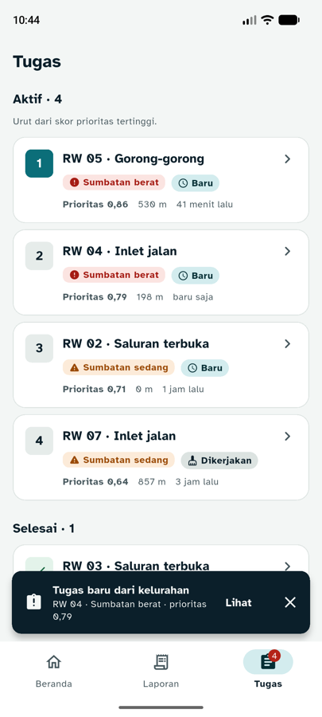
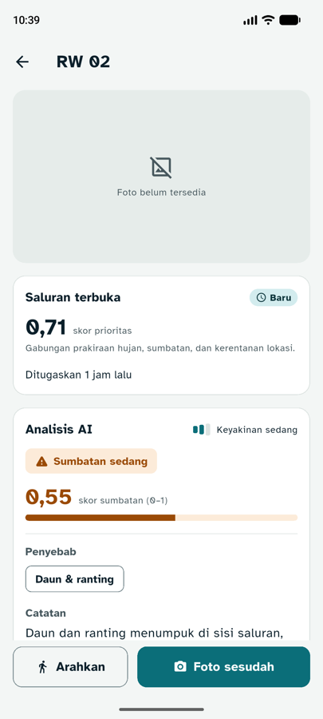
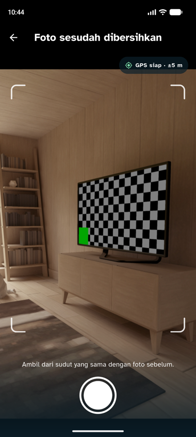
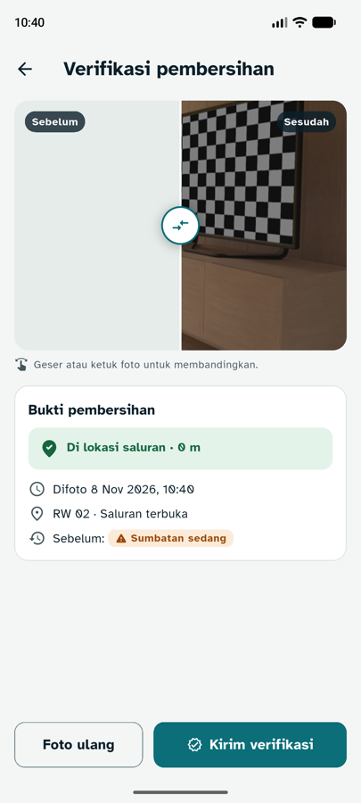
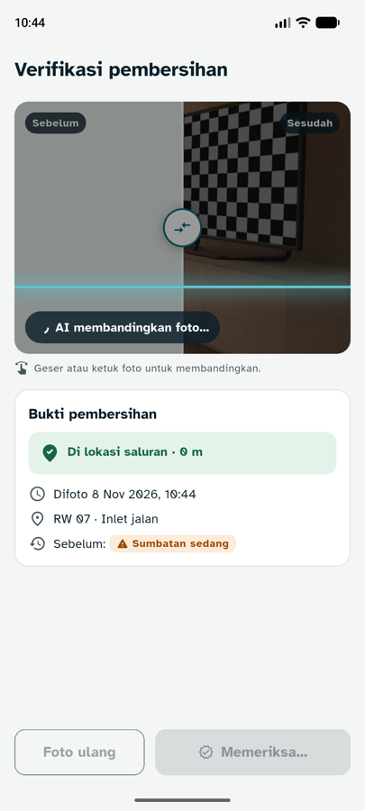
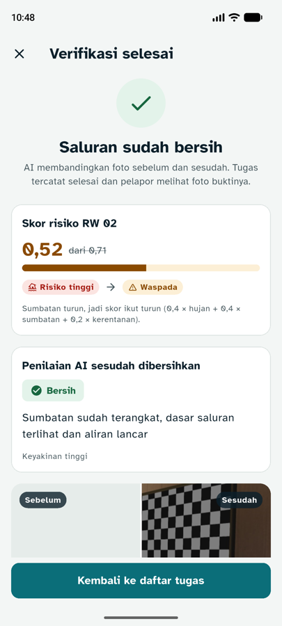
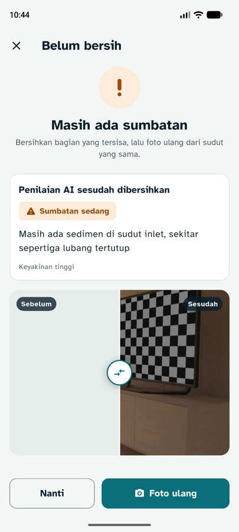
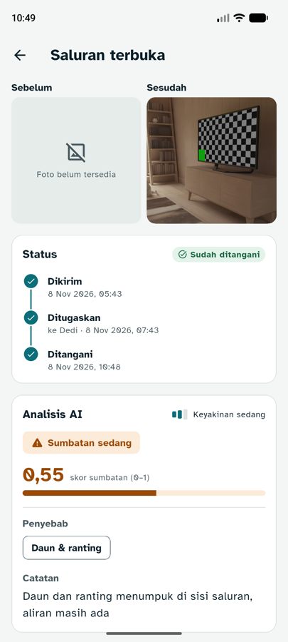
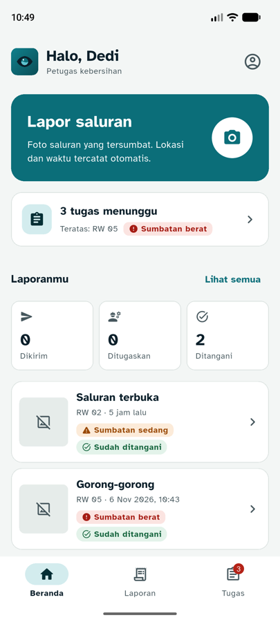
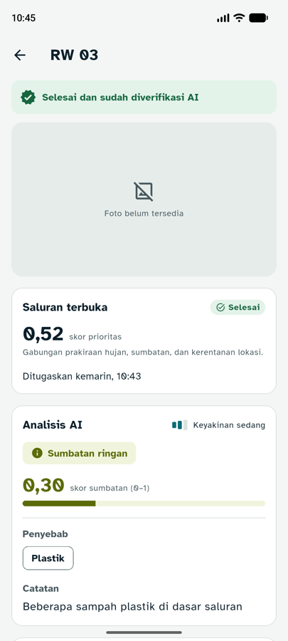

# 03 · Verifikasi Foto Sesudah, Notifikasi Tugas, dan Polish (jam 8–10)

**Tanggal:** 8 November 2026 · **Branch:** `feature/mobile`
**Acuan proposal:** 3.2 langkah 4 (verifikasi: foto ulang, AI membandingkan sebelum–sesudah, skor RW diperbarui, pekerjaan tercatat), Tabel 3 (Verifikasi sebelum–sesudah; Penugasan dan notifikasi), Tabel 8 (foto wajib dari kamera dengan GPS; status "sudah ditangani" + foto dikirim ke pelapor), Tabel 12 (Firebase Cloud Messaging), Tabel 14 jam 8–10

Dengan tahap ini, siklus **Lapor → Prediksi → Bertindak → Verifikasi** di sisi mobile sudah lengkap.

## Yang dibuat

### 1. Verifikasi foto sesudah dibersihkan

| Langkah | Layar | Isi |
|---|---|---|
| 1 | Detail tugas | Tombol **Foto sesudah** (utama) + **Arahkan** (sekunder) |
| 2 | Kamera mode verifikasi | Judul "Foto sesudah dibersihkan", petunjuk "Ambil dari sudut yang sama dengan foto sebelum", thumbnail foto sebelum sebagai acuan sudut |
| 3 | Tinjau | Pembanding **sebelum/sesudah** (geser atau ketuk), bukti lokasi (jarak ke titik saluran), waktu, kelas sumbatan sebelumnya |
| 4 | Kirim | Garis pindai menyapu foto: "AI membandingkan foto…" |
| 5a | Hasil bersih | Centang, **skor risiko RW turun dengan animasi** (mis. 0,71 → 0,52), level **Risiko tinggi → Waspada**, penilaian AI sesudah, tugas tercatat selesai |
| 5b | Hasil belum bersih | "Masih ada sumbatan" + catatan AI + tombol **Foto ulang**. Tugas tetap "Dikerjakan" |

Setelah verifikasi bersih, laporan warga yang terhubung berubah menjadi **Sudah ditangani** dan foto sesudah tampil di detail laporannya (Tabel 8).

### 2. Notifikasi tugas

| Jalur | Cara kerja | Status |
|---|---|---|
| **Cek berkala** (`TaskWatcher`) | Petugas: daftar tugas dicek tiap 30 detik (mode contoh 10 detik) dan saat app dibuka lagi. Tugas yang belum pernah terlihat → banner "Tugas baru dari kelurahan · RW 04 · Sumbatan berat · prioritas 0,79" + tombol **Lihat** | Jalan, teruji |
| **Push FCM** (`PushService`) | Firebase Cloud Messaging sesuai Tabel 12. Daftarkan token ke `POST /devices`; pesan masuk memicu cek tugas; ketuk notifikasi membuka tab Tugas | Kode siap, **aktif setelah `google-services.json` dipasang** (lihat bawah) |

Banner tidak muncul saat kamera atau layar verifikasi terbuka supaya tidak menutupi tombol utama. Banner ditunda dan muncul setelah layar itu ditutup.

### 3. Polish

| Item | Isi |
|---|---|
| Logo di dalam app | Ikon generik diganti logo **Mata Air** asli (`brand/logo/rivora-mark.svg`), digambar dengan `CustomPainter` tanpa dependensi baru, sama dengan ikon launcher |
| Kamera | Bingkai bidik, chip status GPS langsung ("Mencari GPS…" → "GPS siap · ±5 m"), kilat putih + getar saat jepret, tombol jepret mengecil saat ditekan. Posisi GPS dari pemanasan dipakai langsung kalau < 30 detik, jadi pindah ke layar berikutnya lebih cepat |
| AI menganalisis | Garis pindai warna Bening di atas foto saat laporan atau verifikasi dikirim |
| Hasil AI | Angka skor naik dari 0 ke nilai akhir dan bar terisi (700 ms, deselerasi) |
| Memuat | Kartu kerangka berdenyut halus, bukan spinner |
| Gerak | Token `Motion` (150 / 250 / 700 ms, masuk deselerasi, keluar akselerasi). **Semua animasi mati** kalau "Hapus animasi" di Android aktif |

## File baru dan berubah

| File | Isi |
|---|---|
| `lib/models/verification.dart` | `VerificationResult`, `LevelRisiko` (aman < 0,40 · waspada < 0,70 · risiko tinggi) |
| `lib/screens/verify_screen.dart` | Alur tinjau → kirim → hasil |
| `lib/screens/camera_screen.dart` | Mode verifikasi, chip GPS, bingkai, kilat |
| `lib/screens/task_detail_screen.dart` | Tombol Foto sesudah + Arahkan, banner selesai |
| `lib/screens/app_shell.dart` | Banner tugas baru, tunda saat layar fokus, start/stop notifikasi |
| `lib/screens/lapor_flow.dart` | + `mulaiVerifikasi()` |
| `lib/services/api_client.dart` | + `verifyTask`, `registerDevice`, data contoh verifikasi + tugas baru |
| `lib/services/repositories.dart` | Deteksi tugas baru (`tugasMasuk`), `replace()`, foto sesudah lokal, refresh diam-diam |
| `lib/services/task_watcher.dart` | Cek tugas berkala |
| `lib/services/push_service.dart` | FCM opsional |
| `lib/app_keys.dart` | `navigatorKey`, `messengerKey`, `layarFokus` |
| `lib/widgets/before_after.dart` | Pembanding sebelum/sesudah |
| `lib/widgets/motion.dart` | `AnimatedScore`, `AnimatedBar`, `ScanOverlay`, `Skeleton`, `SkeletonList` |
| `lib/widgets/rivora_mark.dart` | Logo Mata Air + ikon aplikasi |
| `lib/widgets/status_chip.dart` | + `RisikoChip` |
| `lib/theme/app_theme.dart` | + token `Motion`, warna `waspada`, padding tombol |
| `android/settings.gradle.kts`, `android/app/build.gradle.kts` | Plugin google-services, aktif hanya kalau `google-services.json` ada |
| `test/tahap03_test.dart` | 7 tes baru |

Package baru: `firebase_core`, `firebase_messaging`.

## Keputusan teknis

- **Jarak maksimal 100 m [ASUMSI]** antara posisi petugas dan titik saluran saat foto sesudah. Turunan Tabel 8 (foto wajib dengan GPS supaya tidak ada laporan palsu). Dengan server asli, tombol Kirim dikunci kalau lebih jauh. Di mode contoh hanya peringatan, karena tugas contoh ada di Gedebage.
- **Notifikasi dua jalur.** Cek berkala selalu jalan, jadi demo tidak bergantung pada Firebase. FCM mempercepat kalau sudah dikonfigurasi.
- **FCM memakai registration token**, bukan API baru `register()` yang mengirim Firebase Installation ID. Backend dengan `firebase-admin` mengirim berdasarkan token (`messaging.send({ token })`).
- **Build tetap jalan tanpa Firebase.** Plugin google-services hanya diterapkan kalau `android/app/google-services.json` ada. `Firebase.initializeApp()` yang gagal ditangkap dan FCM dimatikan.
- **Token FCM dihapus saat keluar** supaya HP tidak menerima notifikasi untuk pengguna sebelumnya.
- **Banner tugas baru hilang sendiri (8 detik) + tombol tutup.** Flutter versi ini membuat snackbar yang punya tombol aksi menetap secara bawaan (`persist`).
- **Rumus skor di data contoh** mengikuti proposal 3.3: skor RW turun sebesar 0,4 × penurunan skor sumbatan.

## Usulan kontrak untuk backend (perlu disepakati dengan B)

### `POST /tasks/:id/verify` (multipart)

Request: `foto` (JPEG), `lat`, `lng`, `captured_at` (ISO UTC).

Respons:

```json
{
  "verifikasi": {
    "sudah_bersih": true,
    "kelas_sesudah": "bersih",
    "skor_sumbatan_sesudah": 0.08,
    "keyakinan": "tinggi",
    "catatan": "Sumbatan sudah terangkat, dasar saluran terlihat dan aliran lancar"
  },
  "tugas": { "...": "objek tugas seperti GET /tasks, status sudah diperbarui" },
  "rw": { "nama": "RW 02", "skor_sebelum": 0.71, "skor_sesudah": 0.52 },
  "foto_sesudah_url": "https://…/tugas/7-sesudah.jpg"
}
```

- `verifikasi` = format verifikasi di `docs/API.md` (turunan Lampiran C).
- Kalau `sudah_bersih: true`: tugas → `selesai`, laporan terkait → `ditangani` + `ditangani_at` + `foto_sesudah_url`.
- `tugas` dan `rw` boleh tidak ada; app tetap jalan, hanya tanpa animasi skor RW.

### `POST /devices`

Request: `{ "fcm_token": "…" }`. Simpan per pengguna yang login (boleh lebih dari satu HP).

### Format push FCM

| Kejadian | `notification` | `data` |
|---|---|---|
| Lurah menugaskan petugas | title "Tugas baru dari kelurahan", body "RW 05 · Sumbatan berat · prioritas 0,86" | `{ "jenis": "tugas_baru", "task_id": "7" }` |
| Laporan warga ditangani | title "Laporanmu sudah ditangani", body "Saluran terbuka di RW 02 sudah dibersihkan" | `{ "jenis": "laporan_ditangani", "report_id": "42" }` |

Contoh di backend (Node.js, firebase-admin):

```js
await admin.messaging().send({
  token,
  notification: { title: 'Tugas baru dari kelurahan', body: 'RW 05 · Sumbatan berat · prioritas 0,86' },
  data: { jenis: 'tugas_baru', task_id: String(task.id) },
  android: { priority: 'high' },
});
```

## Menyalakan FCM

1. Buat project di [Firebase Console](https://console.firebase.google.com) memakai akun tim.
2. Tambah aplikasi Android dengan package **`id.rivora.rivora`**.
3. Unduh `google-services.json`, taruh di `mobile/android/app/`. File ini sudah di-`.gitignore`; bagikan lewat Discord, jangan di-commit.
4. Build ulang (`flutter run`). Saat app dibuka, Android 13+ akan meminta izin notifikasi.
5. Backend: Project settings → Service accounts → Generate new private key, simpan sebagai file service account sesuai `FIREBASE_SERVICE_ACCOUNT_PATH` di `.env` backend (juga jangan di-commit).

## Mode contoh

- **Verifikasi:** tugas RW 02 langsung bersih dan menautkan laporan warga RW 02. Tugas RW 07 sengaja **gagal di percobaan pertama**, berhasil di percobaan kedua.
- **Notifikasi:** tugas baru **RW 04** dikirim 20 detik setelah daftar tugas pertama kali dimuat. Banner muncul di pengecekan berikutnya (≤ 10 detik).

## Hasil uji

**Otomatis:** `flutter analyze` bersih, `flutter test` 20/20 lulus (7 baru: batas level risiko, parsing verifikasi lengkap dan datar, t2 bersih + laporan ditangani, t3 gagal lalu berhasil, tugas tidak ada ditolak, tugas baru muncul setelah jeda). `flutter build apk --debug` berhasil **tanpa** `google-services.json`.

**Emulator Pixel 8 (mode contoh):**

| Skenario | Hasil |
|---|---|
| Buka tab Tugas, tunggu ±25 detik | Banner tugas baru RW 04 + Lihat, daftar urut ulang, badge 3 → 4 |
| Detail tugas RW 02 → Foto sesudah | Kamera mode verifikasi, chip "GPS siap · ±5 m", bingkai bidik |
| Jepret → Tinjau | Pembanding sebelum/sesudah, "Di lokasi saluran · 0 m" |
| Kirim | Garis pindai + "AI membandingkan foto…", lalu "Saluran sudah bersih", skor RW 02 0,71 → 0,52, Risiko tinggi → Waspada |
| Kembali → Laporan | Laporan RW 02 "Sudah ditangani", timeline "Ditangani 10:48", foto sesudah tampil; statistik Ditangani 1 → 2 |
| Tugas RW 07 percobaan pertama | "Masih ada sumbatan" + Foto ulang; tugas tetap Dikerjakan |
| Kamera terbuka saat tugas baru masuk | Tidak ada banner selama 32 detik; banner muncul setelah kembali ke daftar |
| Tugas yang sudah selesai | Banner "Selesai dan sudah diverifikasi AI", tanpa tombol aksi |

**Bug yang ditemukan dan diperbaiki saat uji:** label "Arahkan" dan "Foto ulang" terpotong jadi dua baris (padding tombol 24 → 16, lebar 2:3); banner menutupi tombol jepret (snackbar beraksi menetap + muncul saat kamera aktif); teks overlay pindai overflow 16 px; foto sesudah tidak memenuhi kolom di detail laporan; precedence cascade `..` di `app_shell` (ditangkap analyzer sebelum jalan).

**Belum diuji:** push FCM sungguhan (perlu project Firebase), TalkBack pada pembanding sebelum/sesudah, dan semua endpoint dengan backend asli.

| Notifikasi | Detail tugas | Kamera verifikasi | Tinjau |
|---|---|---|---|
|  |  |  |  |

| AI membandingkan | Hasil: bersih | Hasil: belum bersih | Laporan warga ditangani |
|---|---|---|---|
|  |  |  |  |

| Beranda dengan logo Mata Air | Tugas selesai |
|---|---|
|  |  |

Foto berasal dari kamera virtual emulator. "Foto belum tersedia" muncul karena data contoh tidak punya foto sebelum.

## Berikutnya (jam 10–11)

- Sambungkan ke backend asli (`--dart-define=API_URL=…`) dan uji semua endpoint bersama B.
- Build APK release untuk demo dan video: `flutter build apk --release --dart-define=API_URL=https://<domain-backend>`.
- Merge `feature/mobile` ke `main` sebelum code freeze.
