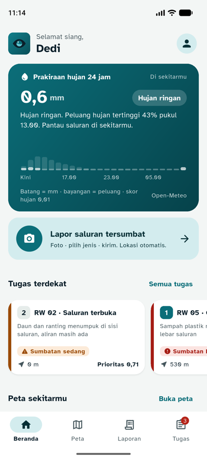
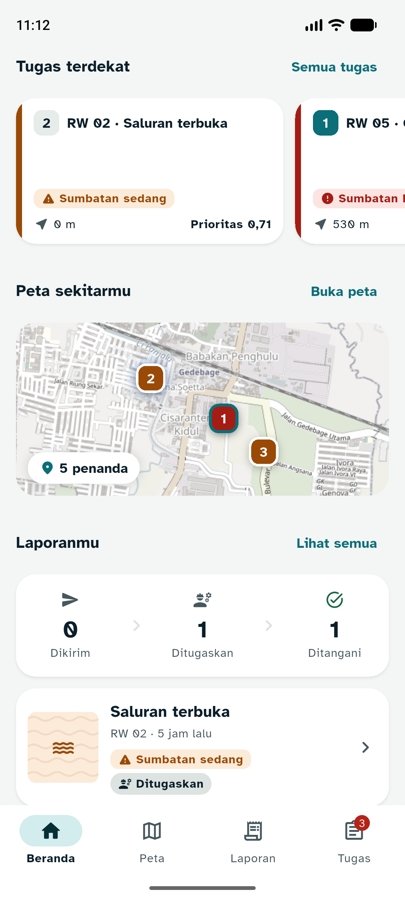
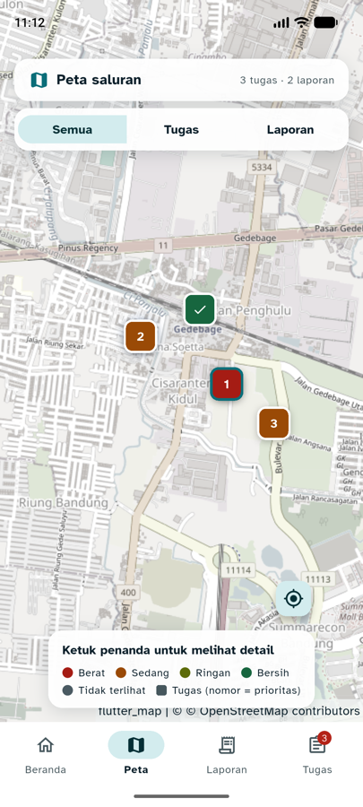
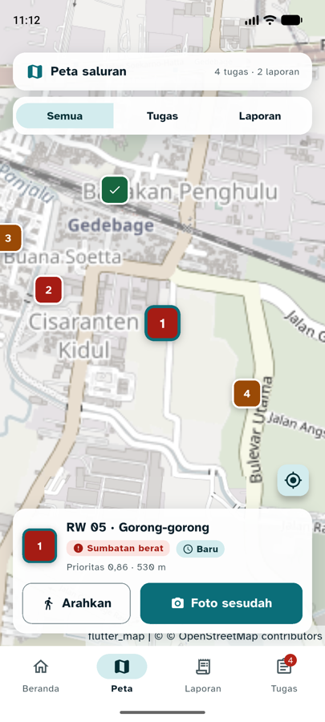
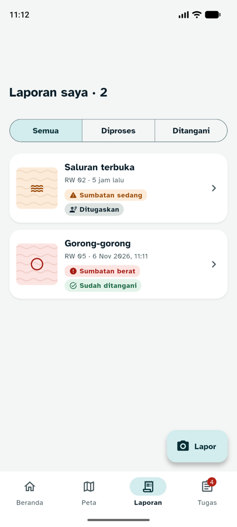
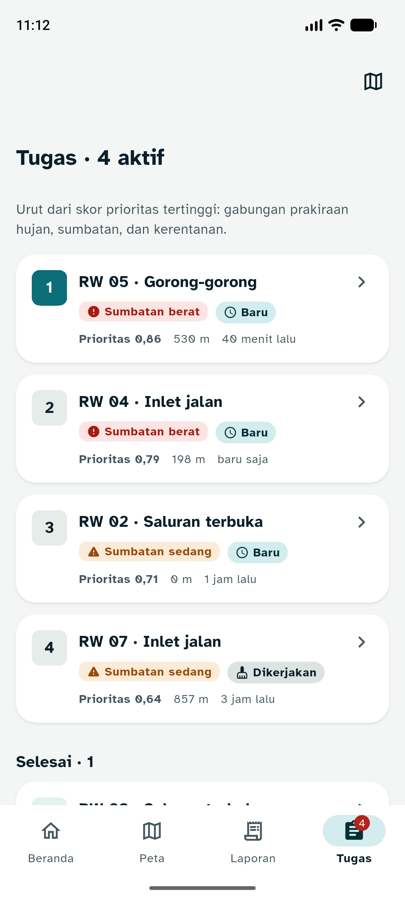
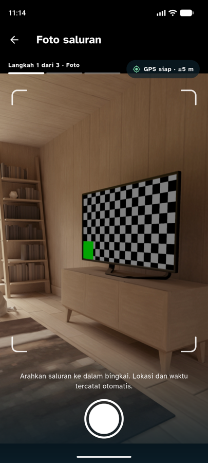
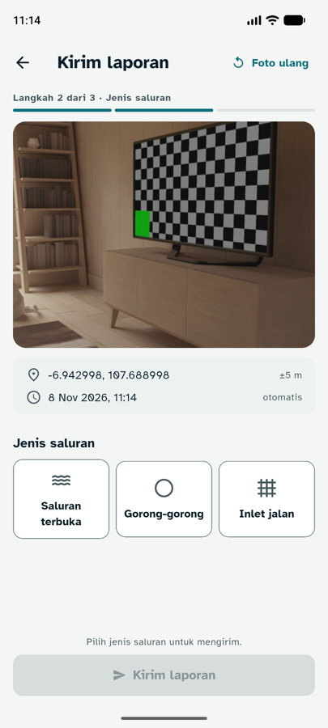
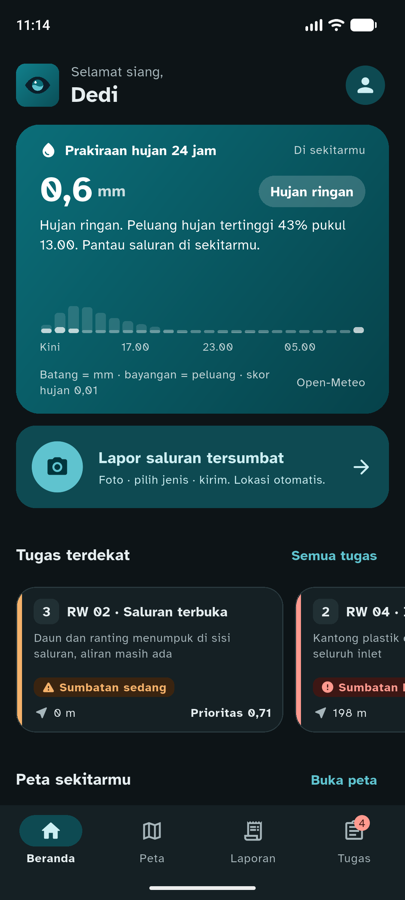
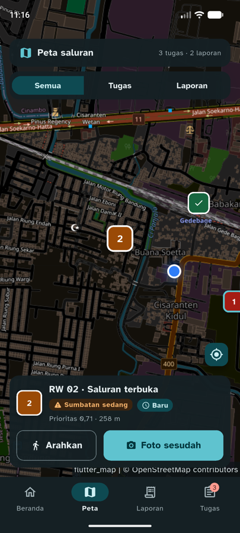

# 04 · Redesign Modern: Hujan, Peta, dan Alur Bertahap

**Tanggal:** 8 November 2026 · **Branch:** `feature/mobile`
**Acuan proposal:** 3.2 (siklus Lapor → Prediksi → Bertindak → Verifikasi), Tabel 2 (komponen hujan dari Open-Meteo), Tabel 3 (Peta risiko), Tabel 12 (Leaflet + OpenStreetMap, Open-Meteo)

Prinsip tahap ini: **fungsi dulu, baru tampilan**. Setiap perubahan visual juga menambah informasi atau mempercepat tugas pengguna.

## Audit tampilan sebelumnya

| Masalah | Dampak |
|---|---|
| Beranda hanya tumpukan kartu putih | Tidak ada konteks kenapa harus lapor sekarang |
| Tahap **Prediksi** (hujan) tidak terlihat di app | Petugas dan warga tidak tahu kapan hujan lebat datang |
| Tidak ada peta sama sekali | Padahal saluran dan tugas itu soal lokasi |
| Daftar tugas tanpa konteks jarak di beranda | Petugas harus buka tab Tugas dulu |
| Placeholder foto abu-abu "Foto belum tersedia" | Daftar terlihat rusak di mode contoh |
| AppBar kecil standar, kartu bergaris | Terasa seperti template bawaan |
| Alur lapor tanpa penanda langkah | Pelapor tidak tahu sisa langkahnya |

## Referensi

| Referensi | Pola yang diambil |
|---|---|
| [Gobojongsoang.id (Bandung)](https://setiadyanwar.vercel.app/portfolio/gobojongsoang) | Alur lapor 3 langkah (foto → lokasi → detail), peta laporan, pelacak status seperti pelacak pengiriman, teks besar dan kontras tinggi |
| [Studi kasus City of Calgary 311](https://contra.com/p/rmcPLQYq-case-study-city-of-calgary-311-app) | Alur bertahap dengan indikator progres, tombol besar, layar konfirmasi di akhir |
| FixMyStreet, SeeClickFix | Pin di peta tanpa perlu tahu instansi yang bertanggung jawab |
| Weathergraph, RainViewer, Dark Sky ([rangkuman](https://nightingaledvs.com/dark-sky-weather-data-viz/)) | Hujan per jam sebagai batang, angka besar, sekali lihat langsung paham |
| App field service (Dynamics 365, NetSuite FSM) | Daftar tugas + peta; aksi "detail" dipisah dari "navigasi" |
| Dribbble "weather app mobile" | Hero bergradien dengan angka besar, kartu membulat |
| Material 3 (Android) | Large top app bar yang mengecil saat digulir, FAB extended, sudut lebih besar |

## Yang dibuat

### 1. Hero prakiraan hujan (data nyata)

- Data **Open-Meteo** (sumber yang sama dengan proposal Tabel 2), 24 jam ke depan, di posisi pengguna. Kalau posisi belum ada, memakai titik pilot Gedebage dan ditandai "Gedebage (perkiraan)".
- Total mm dalam angka besar + **kategori BMKG** (tidak hujan / ringan / sedang / lebat / sangat lebat / ekstrem).
- Kalimat tindakan sesuai kondisi, mis. "Hujan lebat mulai sekitar 15.00. Bersihkan saluran tersumbat sebelum itu." atau "Peluang hujan tertinggi 43% pukul 13.00".
- Grafik 24 batang: **batang = curah hujan (mm)**, **bayangan = peluang hujan (%)**.
- **Komponen hujan skor risiko** (total ÷ 100 mm, RENCANA_FINAL bagian 4) ditampilkan supaya rumus proposal terlihat.
- Warna kartu ikut kondisi: teal (tidak/ringan), cokelat (sedang), merah tua (lebat ke atas).
- Disimpan 15 menit, tarik ke bawah untuk paksa refresh.

### 2. Tab Peta (baru)

- Semua laporan (penanda bulat berwarna kelas sumbatan + ikon) dan tugas (penanda kotak dengan **nomor urut prioritas**, centang kalau selesai). Titik biru = posisimu.
- Filter lapisan untuk petugas: Semua / Tugas / Laporan.
- Ketuk penanda → peta mendekat + **kartu ringkas** dari bawah: laporan (Maps, Lihat detail) atau tugas (**Arahkan**, **Foto sesudah**). Ketuk peta kosong untuk menutup.
- Legenda warna, tombol ke posisimu, atribusi OpenStreetMap.
- Dibuat dengan `flutter_map` (port Leaflet untuk Flutter), sesuai proposal Tabel 12.

### 3. Beranda baru

Urutan mengikuti siklus proposal: **Prediksi** (hero hujan) → **Lapor** (CTA) → **Bertindak** (tugas terdekat) → peta → **status** laporan.

- Sapaan sesuai waktu ("Selamat siang, Dedi").
- Tombol lapor dengan subjudul langkah: "Foto · pilih jenis · kirim. Lokasi otomatis."
- **Tugas terdekat** (petugas): carousel horizontal urut jarak, garis warna kelas di kiri, nomor prioritas, catatan AI, jarak, skor prioritas.
- **Pratinjau peta** dengan jumlah penanda; ketuk untuk membuka tab Peta.
- **Pelacak status** Dikirim → Ditugaskan → Ditangani.

### 4. Polish lain

| Item | Isi |
|---|---|
| Large title | Laporan dan Tugas memakai judul besar yang mengecil saat digulir, dengan jumlah ("Tugas · 4 aktif") |
| FAB "Lapor" | Di layar Laporan saya |
| Tombol peta | Di AppBar Tugas |
| Indikator langkah | "Langkah 1 dari 3 · Foto" di kamera, "Langkah 2 dari 3 · Jenis saluran" di form, berubah ke langkah 3 saat mengirim |
| Placeholder foto | Latar warna kelas sumbatan + tekstur gelombang air + ikon jenis saluran |
| Kartu | Sudut 20, light mode tanpa garis dengan bayangan lembut, dark mode tetap bergaris |

## Keputusan teknis

- **Tile peta OpenStreetMap standar**, diredam saturasinya (±30%) supaya penanda status menonjol; mode gelap memakai filter gelap bawaan flutter_map. Basemap CARTO sempat dicoba tapi **sekarang wajib API key** (tile keluar watermark "API KEY REQUIRED").
- Aturan tile OSM: `User-Agent` diisi (`flutter_map (id.rivora.rivora)`) dan atribusi tampil. Cukup untuk pilot; untuk skala kota perlu penyedia tile sendiri atau berbayar.
- **Penanda peta selalu warna pekat** (versi terang) di kedua tema, karena warna pastel versi gelap membuat angka putih tidak terbaca.
- **Open-Meteo dipanggil langsung dari app** (tanpa key) supaya prakiraan tetap tampil di mode contoh. Saat backend jalan, skor risiko resmi tetap dihitung backend; angka di app hanya informasi.
- Tab bawah jadi 4: Beranda, Peta, Laporan, Tugas (tetap ≤ 5, pedoman navigasi bawah).

## Kontras (dihitung, WCAG)

| Pasangan | Rasio |
|---|---|
| Putih di gradien teal / cokelat / merah | 5,96 / 7,98 / 8,17 (titik tergelap 11,1–13,6) |
| Putih 88% (teks sekunder) di teal | 5,03 (awalnya 78% = 4,30, gagal, lalu dinaikkan) |
| Putih di penanda berat / sedang / ringan / bersih / tidak terlihat | 7,56 / 6,26 / 5,89 / 6,98 / 7,17 |

## File baru dan berubah

| File | Isi |
|---|---|
| `lib/services/weather_service.dart` | Open-Meteo, `PrakiraanHujan`, `KategoriHujan` BMKG, komponen hujan |
| `lib/widgets/rain_card.dart` | Hero hujan + `RainChart` |
| `lib/widgets/rivora_map.dart` | Peta dasar, `LaporanPin`, `TugasPin`, titik posisi |
| `lib/widgets/step_progress.dart` | Indikator langkah lapor |
| `lib/screens/map_screen.dart` | Tab Peta + kartu ringkas + pratinjau beranda |
| `lib/screens/home_screen.dart` | Beranda baru |
| `lib/screens/reports_screen.dart`, `tasks_screen.dart` | Large title, FAB, tombol peta |
| `lib/screens/app_shell.dart` | Tab Peta, muat prakiraan |
| `lib/screens/camera_screen.dart`, `report_form_screen.dart` | Indikator langkah |
| `lib/widgets/report_photo.dart`, `sumbatan_style.dart` | Placeholder bergaya, `ikonJenis` |
| `lib/theme/app_theme.dart` | Kartu sudut 20 + bayangan, `Radii.xl` |
| `test/tahap04_test.dart` | 6 tes baru |

Package baru: `flutter_map`, `latlong2`.

## Hasil uji

**Otomatis:** `flutter analyze` bersih, `flutter test` 26/26 lulus (6 baru: batas kategori BMKG, ambang "perlu bertindak", total/puncak/mulai/komponen hujan, komponen maksimal 1, tanpa hujan + peluang tertinggi, nilai null dari API).

**Emulator Pixel 8 (mode contoh, data hujan Open-Meteo asli):**

| Skenario | Hasil |
|---|---|
| Beranda | Hero "0,6 mm · Hujan ringan", "Peluang hujan tertinggi 43% pukul 13.00", grafik batang + bayangan peluang |
| Tugas terdekat | Carousel urut jarak, catatan AI tampil |
| Pratinjau peta | Tile OSM diredam, penanda bernomor, "5 penanda" |
| Tab Peta | Penanda laporan + tugas, legenda, filter lapisan; ketuk #1 → kartu dengan Arahkan / Foto sesudah |
| Laporan / Tugas | Large title dengan jumlah, FAB Lapor, kartu berbayangan |
| Kamera → form | "Langkah 1 dari 3 · Foto" → "Langkah 2 dari 3 · Jenis saluran" |
| Dark mode | Beranda dan peta terbaca; penanda tetap kontras |

**Bug yang ditemukan dan diperbaiki saat uji:** tile CARTO butuh API key (ganti ke OSM); atribusi "© ©" dobel; grafik terlihat kosong saat hujan kecil (tambah bayangan peluang); ruang kosong di kartu tugas terdekat (isi catatan AI); penanda pastel tidak kontras di peta gelap; teks sekunder 78% di kartu hujan 4,30:1 (naik ke 88%).

**Belum diuji:** TalkBack di peta, kartu hujan saat hujan lebat sungguhan (warna merah, hanya teruji lewat unit test), tablet/landscape.

| Beranda | Beranda: peta & status | Peta | Peta: kartu tugas |
|---|---|---|---|
|  |  |  |  |

| Laporan saya | Tugas | Kamera: langkah 1 | Form: langkah 2 |
|---|---|---|---|
|  |  |  |  |

| Dark: beranda | Dark: peta |
|---|---|
|  |  |
