# 05 · Audit QA: Kontrak, Alur SRS, Proposal, dan Visual

**Tanggal:** 8 November 2026 · **Branch:** `feature/mobile`
**Acuan:** proposal (3.2, 3.3, Tabel 3, 4, 8, 12), [SRS.md](SRS.md) (mobile), `docs/backend/SRS.md` bagian 5 dan 7 (di `main`)

Tahap ini memeriksa aplikasi sebagai QA, bukan menambah fitur baru. Empat pertanyaan:

1. Apakah app bicara dengan backend sesuai kontrak (backend SRS bagian 7)?
2. Apakah alur pengguna sesuai mobile SRS (siapa login, apa yang disimpan, label demo)?
3. Apakah janji proposal terlihat di app?
4. Apa yang masih terlihat "template AI" (ikon, bentuk, warna)?

Cara audit: baca ulang ketiga dokumen, cocokkan baris per baris dengan kode, lalu jalankan semua alur di emulator Pixel 8 (mode contoh, light dan dark) dan catat apa yang salah.

## A. Kontrak backend (backend SRS bagian 7)

| # | Temuan | Dampak kalau dibiarkan | Perbaikan |
|---|---|---|---|
| A1 | Login dibaca sebagai `{token, role, nama}`, padahal backend `{token, role, pengguna: {id, nama, kelurahan_id}}` | Nama petugas kosong, kelurahan tidak diketahui | `Session.fromJson` membaca `pengguna`; bentuk lama tetap diterima |
| A2 | Laporan membaca `rw`, padahal backend `rw_nama` | RW tidak tampil | `Report` membaca `rw_nama` (cadangan `rw`) |
| A3 | Timeline laporan membaca `ditugaskan_at`, `petugas_nama` di akar | Status "ditugaskan/ditangani" tidak pernah terisi | Baca objek `tugas {status, petugas_nama}` dan `bukti {foto_sesudah_url, kelas_sesudah, selesai_at}` (7.3) |
| A4 | App memanggil `GET /reports?mine=1` yang **tidak ada** di backend | Tab Laporan selalu gagal | Laporan disimpan di HP, status diperbarui lewat `GET /reports/:id` per laporan (sesuai FR-MB-06) |
| A5 | Bentuk tugas lama (`laporan` bersarang, `skor_prioritas`, `ditugaskan_at`) | Daftar tugas tidak bisa dibaca | `Task` mengikuti objek 7.9: `saluran {id, jenis, rw_nama, lat, lng}`, `laporan_id`, `foto_sebelum_url`, `kelas_sebelum`, `skor_sebelum`, `catatan`, `dibuat_at`, `selesai_at`. Analisis AI lengkap diambil dari `GET /reports/:laporan_id` |
| A6 | Verifikasi menganggap selalu ada penilaian | `verifikasi: null` (AI gagal menilai) membuat app crash atau menampilkan "masih kotor" | `VerificationResult.dinilai`; layar "Belum bisa dinilai" + Foto ulang (FR-MB-10) |
| A7 | Skor RW sebelum/sesudah dibaca dari respons verify, padahal tidak ada di 7.10 | Momen "skor turun" tidak muncul | App mengambil `GET /rw/risk` sebelum dan sesudah kirim, lalu menggabungkan (`denganSkorRw`) |
| A8 | Batas jarak verifikasi 50 m, backend menolak > 30 m (FR-BE-17) | Petugas bisa kirim lalu ditolak tanpa penjelasan | Batas 30 m di app, dengan peringatan sebelum kirim |
| A9 | Payload FCM tidak dicek tipenya | Notifikasi lain bisa membuka layar tugas | Hanya `data.type = "tugas_baru"` + `data.tugas_id` yang membuka tugas |
| A10 | `PATCH /tasks/:id` (P2) belum dipakai | Status "dikerjakan" tidak pernah dikirim | Tombol **Mulai kerjakan** di detail tugas |
| A11 | Pesan error backend diganti teks umum | Petugas tidak tahu alasan ditolak (mis. "Terlalu jauh dari saluran") | `_send` menampilkan field `error` dari backend apa adanya |

Catatan: `docs/API.md` (draft milik B) masih berbeda dengan backend SRS bagian 7 (login tanpa `pengguna`, verify tanpa `lat/lng/captured_at`). Mobile mengikuti **backend SRS**. Perlu disamakan oleh B; file itu tidak diubah dari branch mobile.

## B. Alur pengguna vs mobile SRS

| # | Temuan | SRS | Perbaikan |
|---|---|---|---|
| B1 | Warga dipaksa login sebelum bisa melapor | Bagian 2: warga **tanpa login** | App langsung ke Beranda. Login hanya lewat tombol **Masuk petugas** |
| B2 | Akun warga/lurah bisa masuk | FR-MB-07: hanya role `petugas` | Ditolak dengan pesan "Akun ini bukan akun petugas." Sesi non-petugas yang tersimpan dibuang |
| B3 | Laporan saya hilang saat logout | FR-MB-06: disimpan di perangkat | Disimpan di `shared_preferences` (`rivora.laporan_saya`), bertahan setelah app ditutup dan setelah petugas keluar |
| B4 | Catatan dari lurah tidak tampil | FR-MB-08 | Tampil di daftar tugas, kartu tugas terdekat, detail tugas, dan notifikasi |
| B5 | Tidak ada penjelasan sebelum dialog izin | NFR-04 | Lembar "Sebelum memotret" (kamera + lokasi, kenapa dibutuhkan) sekali sebelum dialog sistem |
| B6 | Hasil AI demo tidak diberi label | Bagian 6.3 | Label "Hasil contoh (mode demo)", "Lokasi dipetakan ke saluran contoh", dan "Digabung dengan laporan lain di saluran yang sama" |
| B7 | Detail laporan tidak memuat ulang status | FR-MB-06 | `refreshOne` saat detail dibuka |

## C. Proposal

| # | Janji proposal | Sebelum | Sesudah |
|---|---|---|---|
| C1 | Tabel 4: warga **mengetahui risiko di wilayahnya** | Tidak ada di app | Kartu **Risiko genangan di wilayahmu**: RW di posisi pengguna (ray casting ke poligon `GET /rw/risk`), level, skor, kalimat alasan, rincian hujan/sumbatan/kerentanan + rumus |
| C2 | Tabel 3: peta risiko per RW | Peta hanya pin | Poligon RW berwarna level risiko + nama RW + legenda "Risiko RW" |
| C3 | 3.3: skor turun setelah dibersihkan | Angka dari respons palsu | Dari `GET /rw/risk` sebelum dan sesudah. Teruji: RW 02 0,54 → 0,35 (Waspada → Aman) |
| C4 | Tabel 8: pelapor melihat foto bukti | Ada, tetapi data tidak pernah terisi (A3) | Laporan berubah "Bersih · Sudah ditangani" dengan foto sesudah |
| C5 | Transparansi model | – | Mode demo hujan diberi label: "hujan disimulasikan 50 mm, bukan prakiraan saat ini" supaya tidak bertentangan dengan kartu hujan Open-Meteo |

## D. Visual yang masih terasa template

| # | Temuan | Perbaikan |
|---|---|---|
| D1 | Ikon Material generik di semua tempat | Satu keluarga ikon **Phosphor** (garis tipis seragam, versi Fill hanya tab aktif) lewat `RIcons` (`lib/theme/rivora_icons.dart`). Satu tempat untuk mengganti ikon di seluruh app |
| D2 | Setiap chip punya ikon kecil di depan | Chip status = titik + teks; badge sumbatan = teks berwarna di latar lembut. Ikon hanya bila menambah arti |
| D3 | Garis warna di kiri kartu tugas | Dihapus; nomor prioritas besar + badge |
| D4 | Tekstur gelombang di placeholder foto | Diganti **piktogram jenis saluran** yang digambar sendiri (`JenisPictogram`): penampang saluran terbuka, gorong-gorong di bawah jalan, kisi inlet dengan panah air |
| D5 | Ikon jenis saluran generik di form | Piktogram yang sama, jadi form, daftar, peta, dan detail konsisten |
| D6 | Pin peta bulat/kotak biasa | Pin tetes (`_PinPainter`): laporan 28×36, tugas 34×44 dengan nomor; ujung pin tepat di titik |
| D7 | Hero hujan bergradien | Warna datar per kategori (teal / cokelat / merah tua), teks putih tetap ≥ 4,5:1 |
| D8 | Tombol "Masuk" generik di pojok | "Masuk petugas" berteks jelas, akun petugas lewat lembar bawah "Keluar dari akun petugas" |

## E. Ditemukan saat QA di emulator

| # | Temuan | Perbaikan |
|---|---|---|
| E1 | **Build gagal**: `phosphor_flutter` 2.1.0 tidak bisa dikompilasi di Flutter 3.47 (`IconData` sekarang `final`), dan tidak ada versi baru | Paket dilepas. Font Phosphor Regular + Fill (MIT) dipasang sebagai aset, `RIcons` memakai `IconData` biasa. Lisensi: `mobile/assets/fonts/Phosphor-LICENSE.txt` |
| E2 | Kartu hujan 0,6 mm (Open-Meteo asli) tetapi kartu risiko "hujan 50 mm" (mode contoh) di layar yang sama | Mode contoh memakai `hujan_sumber: simulasi_demo` (sama seperti `PUT /demo/hujan` di backend) dan kartu risiko memberi label demo |
| E3 | Tombol **Lapor** (aksi utama warga) terdorong ke bawah layar oleh kartu risiko | Urutan beranda: hujan → Lapor → tugas terdekat → risiko → peta → laporan. Tombol lapor terlihat tanpa menggulir |
| E4 | Laporan yang sudah ditangani tetap pin merah "Berat" | `Report.kelasKini`: kalau ditangani, warna = kelas sesudah (Bersih). Dipakai pin peta, kartu peta, dan daftar laporan |
| E5 | Poligon RW contoh berupa kotak 150 m yang terlihat acak | Lima RW contoh bersebelahan dengan batas tidak beraturan **[ASUMSI]**. Tes memastikan tiap saluran contoh ada di dalam RW-nya |
| E6 | Label RW tertimpa pin | Label pindah ke sisi utara poligon (35% dari titik paling utara ke pusat), halo ikut tema. Di pratinjau beranda label disembunyikan |
| E7 | Atribusi OpenStreetMap tertutup legenda | Strip kecil di pojok kanan bawah, legenda/kartu digeser 12 dp ke atas |
| E8 | Tiga kartu jenis saluran beda tinggi ("Saluran terbuka" dua baris) | `IntrinsicHeight` + `stretch`, piktogram rata atas |
| E9 | Detail tugas t1/t3/t4/t5 tanpa analisis AI di mode contoh | Mode contoh membuat laporan asal untuk tiap tugas (seperti `GET /reports/:laporan_id`) |
| E10 | "Sumbatan sedang · 0,55" tampil dua kali di detail tugas | Hanya di kartu Analisis AI. Kalau laporan asal gagal dimuat, kartu "Kondisi sebelum" (kelas + skor, tanpa mengarang penyebab) |
| E11 | Chip penyebab bergaris seperti tombol, padahal tidak bisa diketuk | Tag datar tanpa garis |
| E12 | Kartu tugas tanpa catatan menampilkan teks pengisi "Tanpa catatan dari kelurahan." | Diganti "Ditugaskan 3 jam lalu." (abu-abu) |
| E13 | Sisi "Sebelum" di pembanding kosong polos | Piktogram + "Belum ada foto" di setengah kiri (tidak tertutup tuas). Ukuran placeholder mengikuti ruang yang ada |
| E14 | Baris "Sebelum: Sedang" memakai ikon jam | Ikon AI |
| E15 | Ruang kosong besar di atas judul Laporan/Tugas | `SliverAppBar.medium` (lebih pendek dari `large`) |

## Hasil uji

### Tes otomatis

`flutter analyze`: **No issues found**. `flutter test`: **39 tes lulus**.

| File | Isi |
|---|---|
| `test/tahap02_test.dart` | `Report` (tugas, bukti, rw_nama, label demo, `toJson` bolak-balik), `Task` bentuk 7.9, login `pengguna.nama`, `getReport`, digabung < 15 m, Mulai kerjakan |
| `test/tahap03_test.dart` | `VerificationResult` + `denganSkorRw`, `verifikasi: null`, label demo, t2 bersih → skor RW turun + laporan ditangani, t3 gagal lalu berhasil |
| `test/tahap05_test.dart` (baru) | `Session` bersarang + bentuk lama, warga/lurah ditolak, sesi non-petugas dibuang, laporan tersimpan setelah app dibuka ulang, logout tidak menghapus laporan, poligon GeoJSON `[lng, lat]`, titik di dalam/luar RW, rumus skor mock |

### Emulator (Pixel 8, mode contoh, `ALLOW_MOCK_LOCATION=true`)

| Alur | Hasil |
|---|---|
| Buka pertama kali sebagai warga, tanpa login | ✅ Beranda, 3 tab (tanpa Tugas) |
| Lapor: lembar izin → izin lokasi → izin kamera → foto → jenis → kirim → hasil AI | ✅ Label "digabung" muncul karena titik sama dengan laporan contoh |
| Tutup paksa app, buka lagi | ✅ Laporan saya tetap 3 |
| Masuk petugas dengan `warga01` | ✅ "Akun ini bukan akun petugas." |
| Masuk petugas dengan akun contoh | ✅ Nama "Dedi", tab Tugas + badge, kartu risiko jadi "di wilayahmu" |
| Daftar tugas | ✅ Urut berat → sedang, catatan lurah, jarak |
| Detail tugas → Mulai kerjakan | ✅ Status jadi Dikerjakan |
| Foto sesudah dari 530 m | ✅ Peringatan jarak (mode contoh tidak memblokir) |
| Kirim verifikasi t2 | ✅ "Saluran sudah bersih", RW 02 0,54 → 0,35, Waspada → Aman |
| Laporan warga RW 02 setelah verifikasi | ✅ "Bersih · Sudah ditangani" |
| Tugas baru masuk (t5, setelah 20 detik) | ✅ Muncul di daftar, badge tetap benar |
| Peta: poligon RW, label, legenda, atribusi | ✅ Light dan dark |

### Tangkapan layar

| Warga | Lapor | Petugas | Verifikasi |
|---|---|---|---|
| 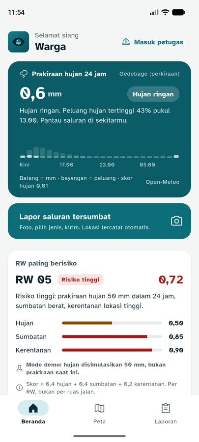 | 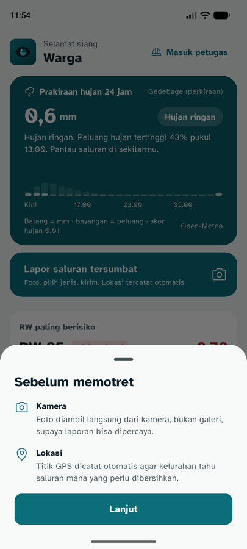 | 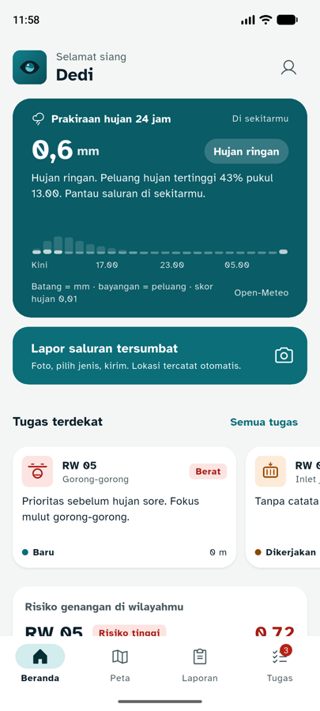 | 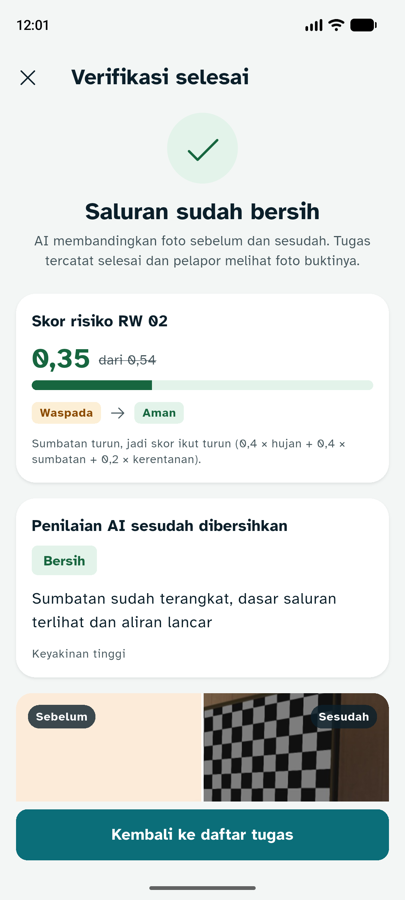 |
| 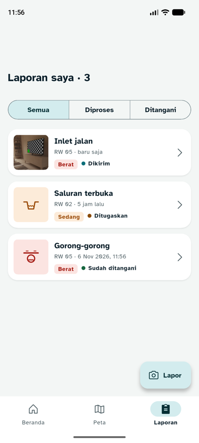 | 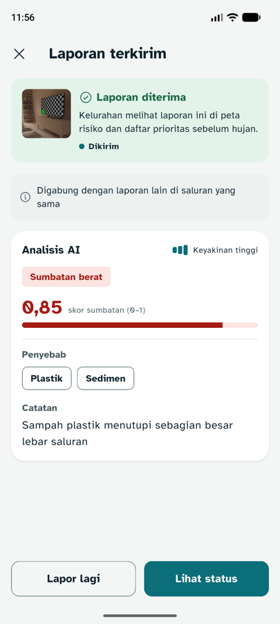 | 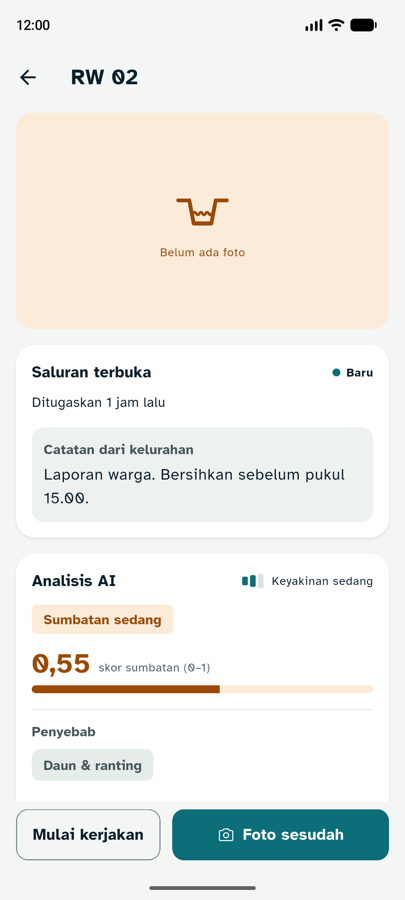 | 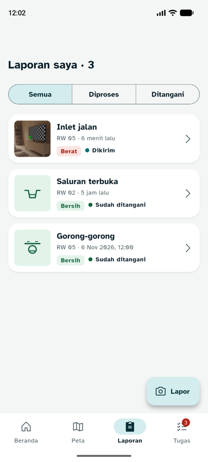 |
| 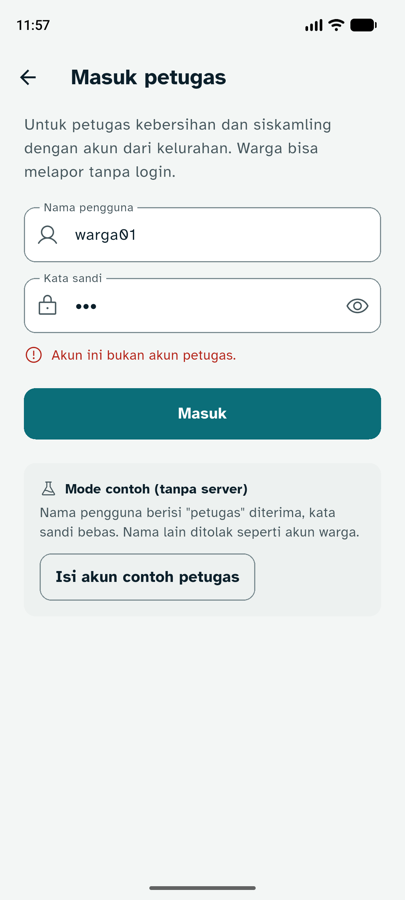 | 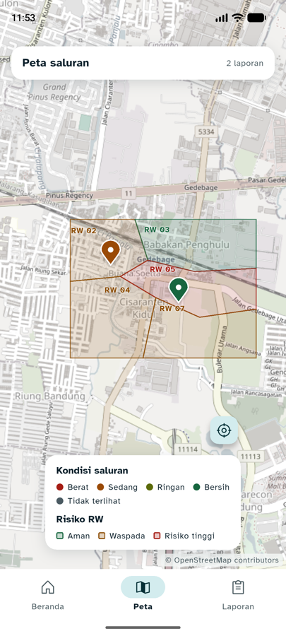 | 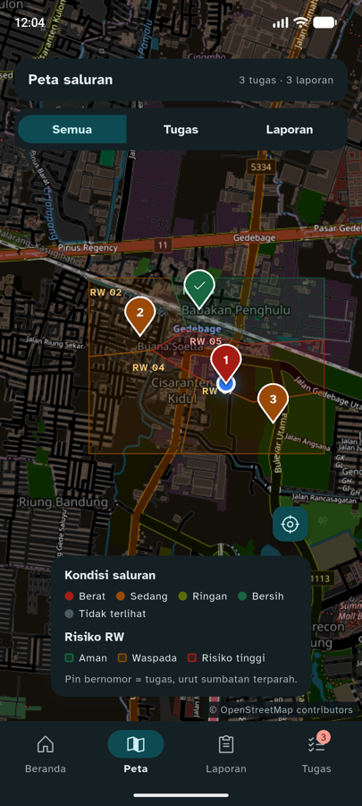 | 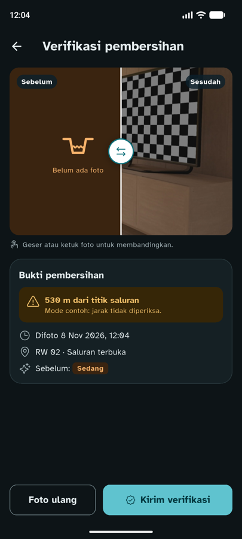 |

Beberapa tangkapan diambil sebelum perbaikan kecil berikutnya (mis. `05-verifikasi-rw-turun.png` masih menunjukkan sisi "Sebelum" kosong, sudah diperbaiki di E13; `05-beranda-petugas.png` sebelum E12).

## Belum teruji / risiko

| Item | Catatan |
|---|---|
| `HttpApiClient` terhadap backend asli | Belum ada backend yang jalan. Bentuk data sudah dicocokkan dengan backend SRS bagian 7 dan diuji lewat mode contoh |
| FCM | Butuh `google-services.json`. Tanpa itu app memakai cek tugas berkala (sudah teruji) |
| Field `pesan` saat `verifikasi: null` | Tidak ada di backend SRS 7.10; app memakai teks sendiri kalau kosong |
| Kelurahan untuk warga tanpa login | Memakai kelurahan pilot `1` **[ASUMSI]**. Petugas memakai `kelurahan_id` dari login |
| Penolakan > 30 m di HP asli | Mode contoh hanya memperingatkan; backend yang menolak |

## File yang berubah

| Bagian | File |
|---|---|
| Model | `models/session.dart`, `report.dart`, `task.dart`, `verification.dart`, `ai_result.dart`, `rw_risk.dart` (baru) |
| Layanan | `services/api_client.dart`, `repositories.dart` (+ `RiskRepository`), `session_store.dart`, `push_service.dart` |
| Layar | Semua di `screens/` (beranda, peta, laporan, detail, tugas, detail tugas, verifikasi, login, alur lapor, form, hasil, shell) |
| Komponen | `widgets/pictogram.dart` (baru), `risk_card.dart` (baru), `rivora_map.dart`, `report_photo.dart`, `status_chip.dart`, `sumbatan_style.dart`, `rain_card.dart`, `report_tile.dart`, `before_after.dart`, `ai_result_card.dart` |
| Tema | `theme/rivora_icons.dart` (baru) |
| Aset | `assets/fonts/Phosphor-Regular.ttf`, `Phosphor-Fill.ttf`, `Phosphor-LICENSE.txt` |
| Tes | `test/tahap02_test.dart`, `tahap03_test.dart`, `tahap05_test.dart` (baru) |
