# 06 · Tampilan Ramah Warga: Kata dan Gambar Dulu, Angka Belakangan

**Tanggal:** 8 November 2026 · **Branch:** `feature/mobile`
**Acuan:** proposal 3.1 (pengguna: petugas, siskamling, warga), 3.3 (transparansi model), Tabel 4 (warga mengetahui risiko di wilayahnya), Tabel 8 (keyakinan AI selalu ditampilkan)

## Masalah

Setelah tahap 05, app masih ditulis dari sudut pandang proposal dan juri, bukan warga. Contoh yang muncul langsung di layar:

| Layar | Teks yang membingungkan |
|---|---|
| Kartu hujan | "0,6 mm" dibuat besar, keterangan "Batang = mm · bayangan = peluang · skor hujan 0,01" |
| Kartu risiko | Skor "0,72", tiga bar desimal, "Skor = 0,4 hujan + 0,4 sumbatan + 0,2 kerentanan" |
| Hasil AI | "0,85 skor sumbatan (0–1)", "Keyakinan tinggi" |
| Verifikasi | "0,35 dari ~~0,54~~" + rumus "(0,4 × hujan + 0,4 × sumbatan + 0,2 × kerentanan)" |
| Form, detail laporan, detail tugas | Koordinat "-6.944098, 107.691198" |

Warga tidak butuh angka 0–1 atau rumus. Mereka butuh jawaban dua pertanyaan: **bahaya atau tidak**, dan **saya harus apa**.

## Referensi

| Referensi | Pola yang diambil |
|---|---|
| Aplikasi kualitas udara (pola umum, mis. verdict "Great day to be outside") | Satu kalimat kesimpulan di atas, angka di bawahnya; saran sesuai kondisi |
| [Google Flood Hub](https://sites.research.google/gr/floodforecasting/flood-hub-expert-mode) | Tingkat bahaya bertahap berwarna (normal → waspada → bahaya), bukan angka |
| [RainViewer](https://rainviewer.com/blog/welcome-to-rainviewer-2.html), Apple Weather | Grafik hujan per jam yang langsung menunjukkan kapan hujan mulai dan reda |
| [Studi kasus Arkly](https://inkaether.myportfolio.com/arkly) (risiko banjir) | Bahasa singkat, mudah dibaca orang tua, sedikit ketukan, selalu ada langkah tindakan |
| [InaRISK (BNPB)](https://www.idntimes.com/tech/trend/aplikasi-resmi-bnpb-deteksi-potensi-bencana-c1c2-01-qt4jm-585d10) | Tingkat risiko wilayah disertai rekomendasi tindakan |
| Esai tentang "banjir 100 tahunan" ([Niklas Jordan](https://niklasjordan.leaflet.pub/3mnssyemuvk2w)) | Istilah teknis risiko hampir tidak bermakna bagi orang awam; nilai antarmuka dari seberapa ia membantu orang bertindak |

## Prinsip

1. **Kata dan warna dulu, angka belakangan.** Angka tetap ada, kecil atau tersembunyi.
2. **Rincian disembunyikan, tidak dihapus.** Satu tombol "Cara RIVORA menilai" membuka angka, bobot, dan rumus. Transparansi untuk juri tetap ada (proposal 3.3).
3. **Setiap kartu menjawab "apa yang terjadi" dan "saya harus apa".**
4. **Gambar menggantikan istilah:** meteran untuk risiko, penampang saluran untuk sumbatan, peta kecil untuk koordinat.
5. Kontrak data dengan backend **tidak berubah**. Hanya cara menampilkannya.

## Yang dibuat

| Layar | Sebelum | Sesudah |
|---|---|---|
| **Kartu cuaca** | "0,6 mm" besar + legenda teknis | Kalimat besar: "Gerimis tipis sesekali" / "Hujan sedang nanti sore" / "Hujan lebat mulai pukul 15.00", saran ("Belum berbahaya. Pantau saluran dekat rumah."), ilustrasi cuaca gambar sendiri (matahari, awan + tetes, kilat untuk lebat). mm dan peluang jadi teks kecil. Grafik tanpa legenda; jam kering berupa titik, tinggi grafik ikut jumlah hujan |
| **Kartu risiko** | Skor + 3 bar desimal + rumus | "RW 05 **Risiko tinggi**", meteran tiga warna (Aman · Waspada · Tinggi) dengan penanda, kotak saran tindakan, "Kenapa?" berisi tiga alasan berbahasa sehari-hari dengan ikon dan tiga titik tingkat. Angka + rumus di lembar **Cara RIVORA menilai** |
| **Hasil AI** | "0,85 skor sumbatan (0–1)" | Gambar penampang saluran yang terisi sampah sesuai tingkat (bersih = air mengalir, tidak terlihat = garis putus + tanda tanya) + kalimat "Hampir tertutup penuh, air sulit mengalir". Keyakinan jadi "AI yakin / AI cukup yakin / AI kurang yakin"; kalau tidak yakin: "Petugas kelurahan akan memastikan langsung di lokasi." |
| **Verifikasi selesai** | Angka turun + rumus | "Risiko genangan RW 02 turun", Waspada → Aman, penanda meteran bergeser dari kuning ke hijau, kalimat "Karena saluran ini sudah bersih, RW 02 sekarang aman. Warga yang melapor ikut melihat hasilnya." |
| **Lokasi** (form, detail laporan, detail tugas) | Koordinat mentah | Peta kecil + "Di RW 05" + "Titik GPS akurat ±5 m" / "530 m dari posisimu". Koordinat tetap dipakai tombol Maps |
| Daftar laporan tanpa RW | Koordinat | "Lokasi GPS tercatat" |

Angka tetap tersedia untuk pembaca layar (TalkBack) lewat label `Semantics`, jadi informasinya tidak hilang.

### Ditemukan saat QA di emulator

| Temuan | Perbaikan |
|---|---|
| Total 0,7 mm tersebar (tidak ada jam ≥ 0,5 mm) ditulis "Hujan ringan sebentar lagi" | Kasus ini sekarang "Gerimis tipis sesekali". "Hujan ringan …" hanya kalau ada jam dengan hujan nyata |
| Pita kosong besar di kartu cuaca saat hampir tidak hujan | Tinggi grafik menyusut sesuai jumlah hujan |
| Label "N penanda" di pratinjau peta menutupi atribusi OSM | Atribusi pindah ke kanan atas khusus pratinjau (`atribusiDiAtas`), label tetap di kiri bawah |
| Kata "Bersih" tampil dua kali di hasil verifikasi | Kalimat bersih jadi "Tidak ada sampah, air mengalir lancar" |
| Emulator kehilangan DNS (Open-Meteo gagal) | Bukan bug app; emulator dijalankan ulang dengan `-dns-server 8.8.8.8` |

## Komponen baru

| Komponen | File | Isi |
|---|---|---|
| `RiskMeter` | `widgets/risk_meter.dart` | Meteran tiga segmen, lebar segmen mengikuti ambang skor (0,40 / 0,70) jadi posisinya jujur terhadap angka. `dari:` menganimasikan penanda dari skor lama ke baru |
| `TingkatFaktor` | `widgets/risk_meter.dart` | Rendah / Sedang / Tinggi untuk nilai komponen 0–1 |
| `CuacaIlustrasi` | `widgets/rain_card.dart` | Ilustrasi cuaca `CustomPainter`, tanpa aset gambar |
| `kataWaktu()` | `widgets/rain_card.dart` | "sebentar lagi", "nanti sore", "besok pagi" |
| `SumbatanVisual` | `widgets/sumbatan_visual.dart` | Penampang saluran terisi sampah/air sesuai kelas, beranimasi |
| `kataSumbatan()`, `kataKeyakinan()` | `widgets/sumbatan_style.dart` | Kalimat kondisi dan keyakinan AI |
| `KeyakinanAi` | `widgets/ai_result_card.dart` | Tiga batang + kata, dipakai kartu AI dan verifikasi |
| `LokasiMini` | `widgets/lokasi_mini.dart` | Peta kecil + nama RW (dari backend atau poligon `GET /rw/risk`) |
| `RivoraMap.atribusi` / `atribusiDiAtas` | `widgets/rivora_map.dart` | Atribusi OSM juga di peta statis |

## Hasil uji

`flutter analyze`: **No issues found**. `flutter test`: **44 tes lulus** (39 sebelumnya + 5 baru di `test/tahap06_test.dart`: kata waktu, ambang tingkat faktor, kalimat tiap kelas/keyakinan, kartu AI tanpa "0–1" dan tanpa "0,85", meteran menyebut level).

Emulator Pixel 8 (mode contoh, light dan dark): beranda warga dan petugas, lembar Cara RIVORA menilai, form lapor dengan peta kecil, hasil AI, detail laporan, detail tugas, verifikasi t2 (penanda bergeser Waspada → Aman).

### Tangkapan layar

| Beranda | Kenapa? | Cara menilai | Mode gelap |
|---|---|---|---|
| 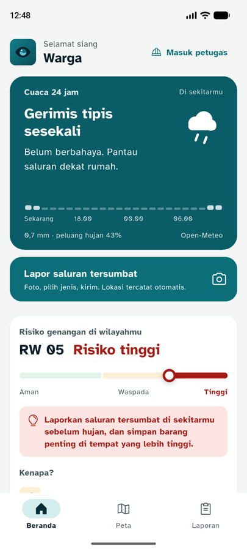 | 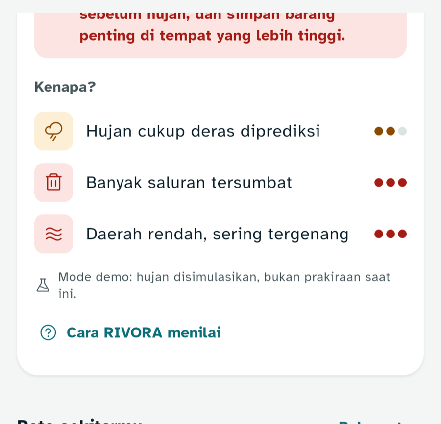 | 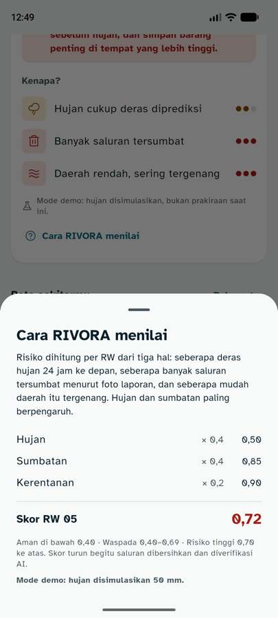 | 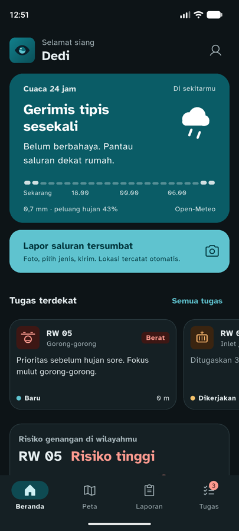 |
| 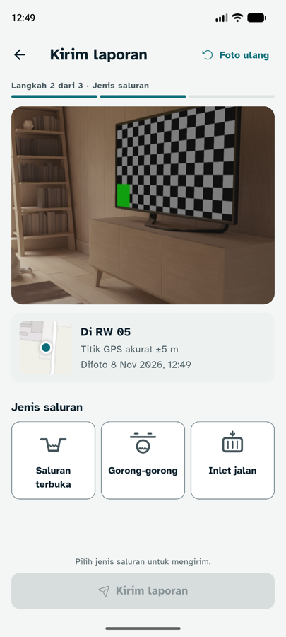 | 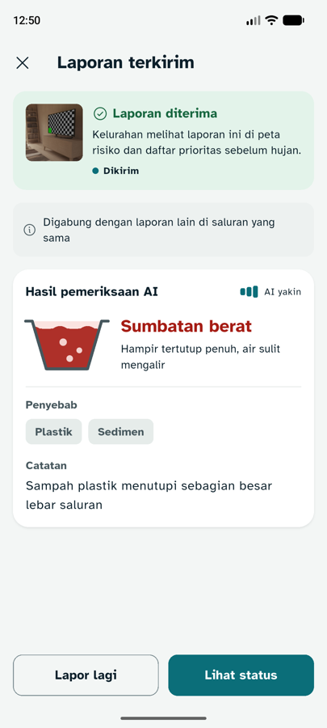 | 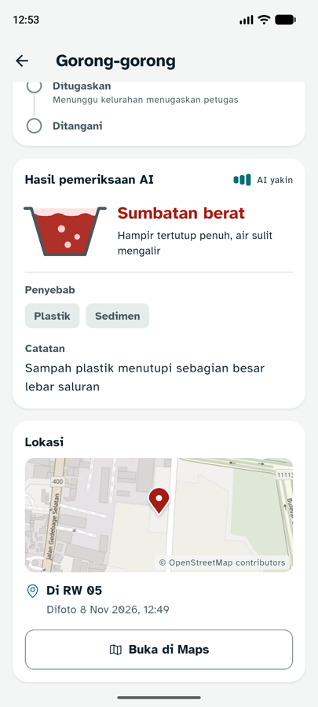 | 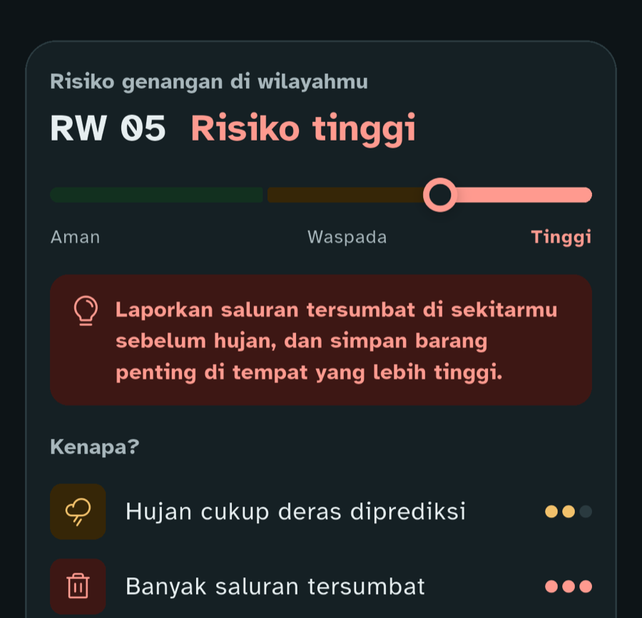 |
| 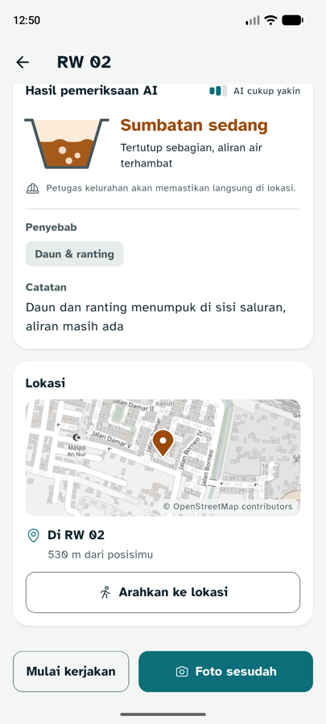 | 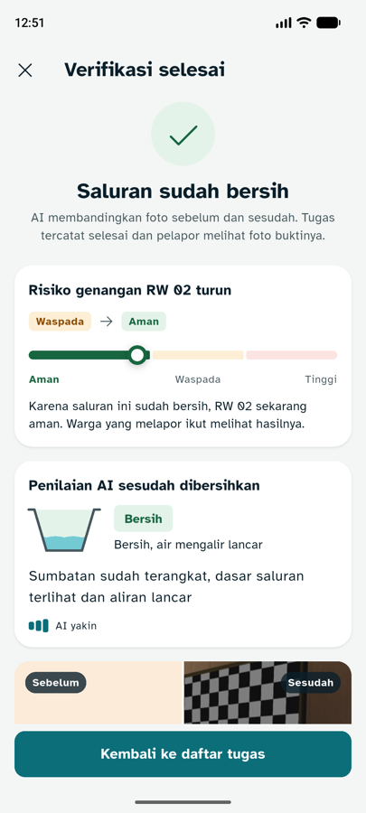 | 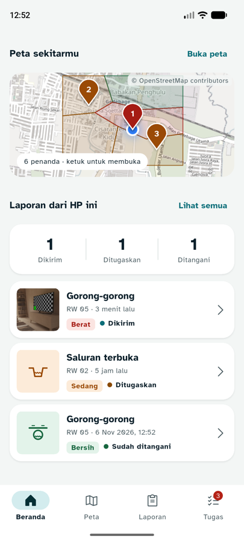 | |

`06-verifikasi.png` diambil sebelum kalimat "Bersih" diganti.

## Catatan

- Rumus lengkap untuk lurah tempatnya di **dasbor** (panel "Kenapa skor ini?", `RENCANA_FINAL.md` bagian 4). Di app cukup lembar ringkas.
- Ilustrasi dan penampang saluran digambar dengan `CustomPainter`, jadi tidak menambah ukuran APK dan ikut warna tema.
