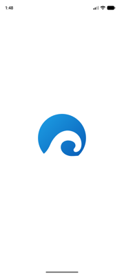
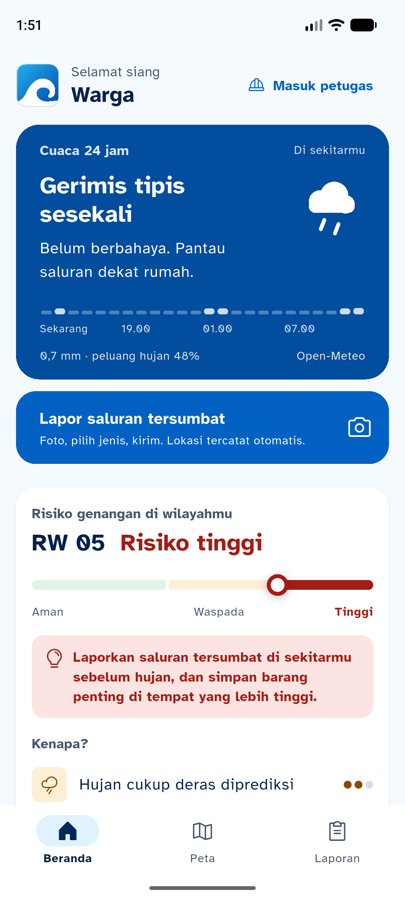
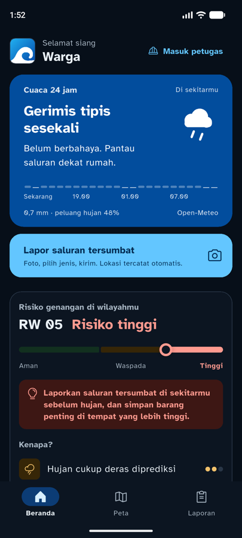

# 08 · QA Rebrand Biru (Logo Ombak)

**Tanggal:** 8 November 2026 · **Branch:** `feature/mobile`
**Diperiksa:** commit `2126232` (brand) dan `f09ad10` (mobile): logo **Ombak**, palet biru air, ikon launcher. Panduan merek: [../BRAND.md](../BRAND.md), [00b-logo-ikon-aplikasi.md](00b-logo-ikon-aplikasi.md)

## Kontras palet baru

Semua pasangan dihitung dengan rumus WCAG 2.1:

| Pasangan | Rasio | Syarat |
|---|---|---|
| Terang: `primary` #0361C3 di latar #F4FAFE | 5,70 | ≥ 4,5 ✅ |
| Terang: teks putih di tombol `primary` | 6,00 | ≥ 4,5 ✅ |
| Terang: `onSurfaceVariant` #47566C di latar | 7,09 | ≥ 4,5 ✅ |
| Terang: `outline` #6E7D91 di latar | 3,99 | ≥ 3 ✅ |
| Terang: teks putih di kartu cuaca #024D9D | 8,23 | ≥ 4,5 ✅ |
| Gelap: `primary` #63C6FF di latar #070F19 | 10,13 | ≥ 4,5 ✅ |
| Gelap: `onPrimary` #012C54 di `primary` | 7,42 | ≥ 4,5 ✅ |
| Gelap: `onSurfaceVariant` #A8B6C3 di kartu | 8,86 | ≥ 4,5 ✅ |
| Gelap: `outline` #728295 di latar | 4,90 | ≥ 3 ✅ |
| `tidakTerlihat` terang / gelap | 6,34 / 7,47 | ≥ 4,5 ✅ |

Tidak ada sisa warna teal lama yang di-hardcode di `lib/`.

## Temuan dan perbaikan

Logo Ombak berupa ombak putih yang menyentuh tepi bawah ikon. Bentuk ini bagus di latar gelap, tapi di latar putih bagian putihnya menyatu dengan latar.

| # | Temuan | Perbaikan |
|---|---|---|
| R1 | **Splash screen Android 12+** memakai latar putih bawaan, sehingga ombak putih hilang dan logo terlihat terpotong datar | `values-v31/styles.xml`: `windowSplashScreenBackground` = biru Laut `#0361C3`; `values-night-v31/styles.xml`: `#070F19` (latar app gelap) |
| R2 | **Logo di header beranda**: sudut kiri bawah menyatu dengan latar halaman #F4FAFE | `RivoraMark` diberi garis tepi 1 dp warna `outlineVariant`, radius 22,3 % (sama dengan ikon) |
| R3 | `docs/mobile/README.md` di `08e9f79` berisi baris 07 dan baris demo **dua kali** (sudah ikut di `f09ad10`, lalu ditambahkan lagi lewat patch) | Baris ganda dihapus |

| Sebelum (splash) | Sesudah, terang | Sesudah, gelap |
|---|---|---|
|  |  |  |

| Beranda terang | Beranda gelap |
|---|---|
|  |  |

## Hasil uji

`flutter analyze`: **No issues found**. `flutter test`: **48 tes lulus**. Emulator Pixel 8: splash terang/gelap, beranda terang/gelap, ikon launcher.

## Catatan untuk tim

Commit rebrand dibuat dari sesi lain di folder yang sama, dan ikut membawa perubahan FCM (`f09ad10`). Supaya riwayat commit tidak tercampur lagi, satu folder sebaiknya hanya dipakai satu sesi kerja pada satu waktu, atau tiap sesi memakai worktree sendiri.
