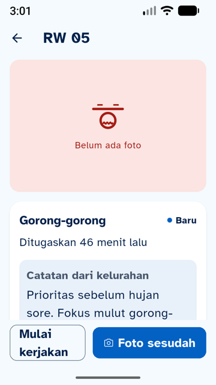
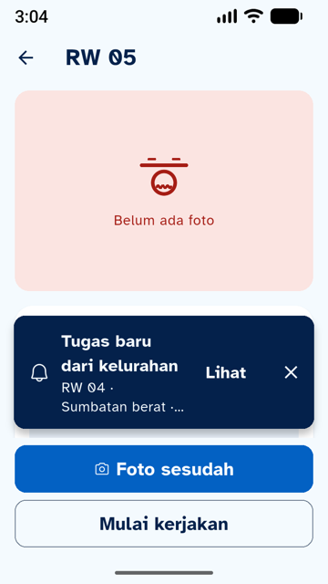
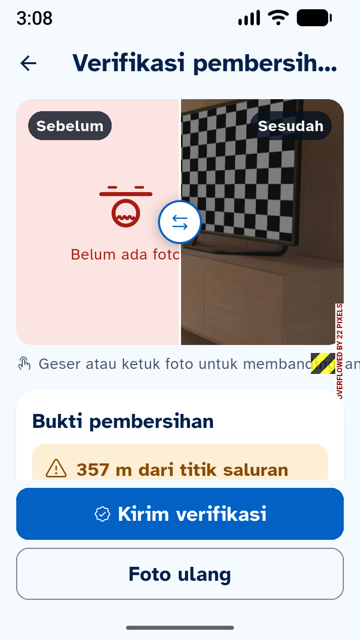
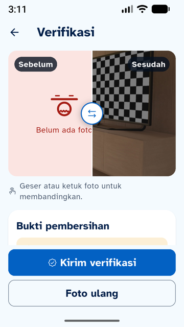
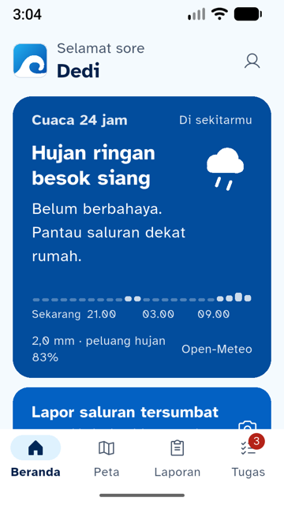
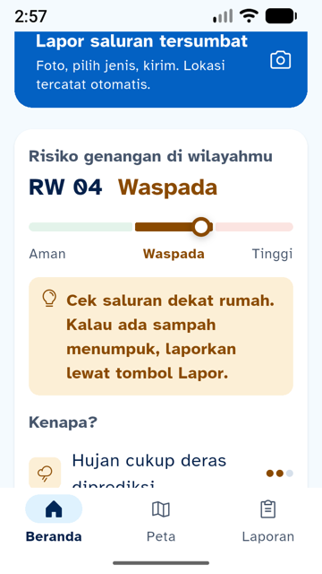
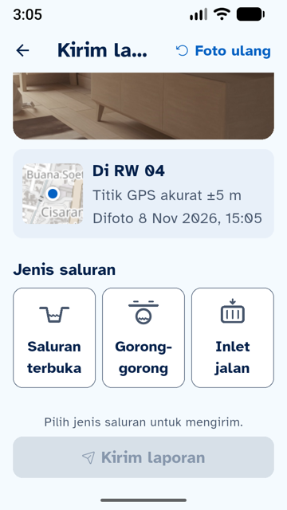

# 09 · Responsif dan Performa (Siap Pitching)

**Tanggal:** 8 November 2026 · **Branch:** `feature/mobile`
**Pertanyaan:** apakah app sudah responsif, cepat, dan rapi untuk pitching?

## Cara uji

| Uji | Cara |
|---|---|
| Kecepatan | `flutter build apk --release --split-per-abi`, dipasang di emulator Pixel 8 (arm64), waktu buka dari kondisi tertutup diukur dengan `adb shell am start -W` (3×) |
| HP kecil + huruf besar | `adb shell wm size 720x1280` + `wm density 320` (= 360 × 640 dp, seukuran HP Android murah) dan `font_scale 1.3` (pengaturan "huruf besar"). Semua layar utama dibuka di build debug supaya overflow terlihat sebagai garis kuning-hitam |
| Pola overflow di kode | Pencarian `Row` berisi teks tanpa `Expanded`/`Flexible` di seluruh `lib/` |

## Kecepatan

| Ukuran | Hasil |
|---|---|
| APK release universal | 54,9 MB |
| APK release **arm64** (`--split-per-abi`) | **19,9 MB**, yang dipakai untuk HP demo |
| Font ikon setelah tree-shaking | Phosphor Regular 489 KB → 13 KB, Fill 449 KB → 1,5 KB |
| Waktu buka (release, emulator) | **~2,1 detik** (2.050 ms, 2.123 ms) |
| Waktu buka (debug) | 13–16 detik. Normal untuk build debug; jangan dipakai untuk demo |

Belum diukur: frame rate per animasi dengan Flutter DevTools (mode profile).

## Temuan HP kecil + huruf 130%

| # | Layar | Temuan | Perbaikan |
|---|---|---|---|
| P1 | Verifikasi | **Overflow 22 px**: petunjuk "Geser atau ketuk foto untuk membandingkan." meluber ke kanan | Teks dibungkus `Expanded` (terlipat) |
| P2 | Detail tugas | "Mulai kerjakan" terlipat dua baris di tombol | Komponen baru `TombolBerpasangan`: di layar sempit tombol ditumpuk (utama di atas) |
| P3 | Verifikasi, hasil laporan, kartu tugas di peta | Pola dua tombol berdampingan yang sama | Semua memakai `TombolBerpasangan` |
| P4 | Beranda (warga) | "Selamat siang" terlipat karena tombol "Masuk petugas" | Sapaan satu baris; di layar sempit label tombol jadi "Petugas" (pembaca layar tetap "Masuk petugas") |
| P5 | Kamera verifikasi | Judul "Foto sesudah dibersi…" terpotong | Judul jadi "Foto sesudah" |
| P6 | Form lapor | Judul "Kirim la…" terpotong oleh "Foto ulang" | Di layar sempit "Foto ulang" jadi ikon dengan tooltip |
| P7 | Verifikasi | Judul "Verifikasi pembersih…" terpotong | Di layar sempit "Verifikasi" |
| P8 | Chip GPS kamera, kartu "Semua tugas selesai", label demo, kotak mode contoh di login | Pola rawan overflow (belum terlihat meluber) | Dibungkus `Flexible`/`Expanded` |

"Layar sempit" = lebar layar ÷ skala huruf < 380 dp (`layarSempit()` di `widgets/common.dart`). Di HP biasa (412 dp, huruf normal) tampilan tidak berubah.

Sisa kecil: di pembanding sebelum/sesudah, label "Belum ada foto" sedikit terpotong tuas pembanding pada HP 360 dp dengan huruf 130%. Tidak terjadi di ukuran normal, dan tidak terjadi kalau laporan punya foto.

| Sebelum | Sesudah |
|---|---|
|  |  |
|  |  |

| Beranda | Risiko | Form lapor |
|---|---|---|
|  |  |  |

Layar lain yang dicek di 360 dp + 130% tanpa masalah: Peta (legenda menutupi ±⅓ peta tapi tetap bisa digeser), Laporan saya (ruang bawah 96 dp untuk tombol Lapor), detail laporan, login, daftar tugas, kamera.

## Hasil uji

`flutter analyze`: **No issues found**. `flutter test`: **56 tes lulus** (`test/tahap09_test.dart`: tombol berdampingan di 412 dp, ditumpuk di 360 dp, ditumpuk di 412 dp dengan huruf 130% tanpa error layout).

## Untuk hari demo

```bash
# APK HP demo (Android arm64, hampir semua HP sekarang)
flutter build apk --release --split-per-abi --dart-define=API_URL=https://<domain-backend> --dart-define=LOKASI_DEMO=true
# hasil: build/app/outputs/flutter-apk/app-arm64-v8a-release.apk
```
