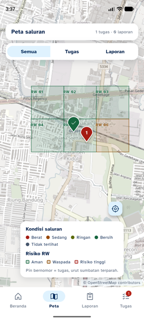
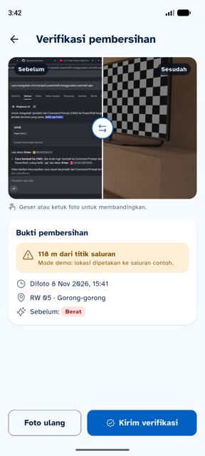
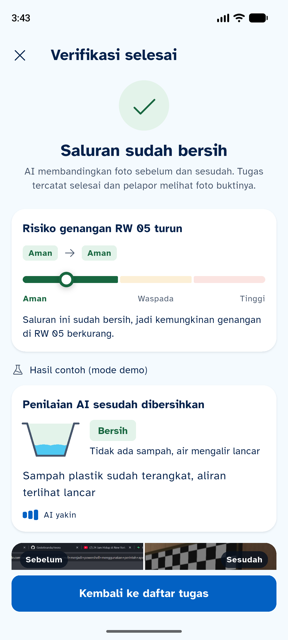
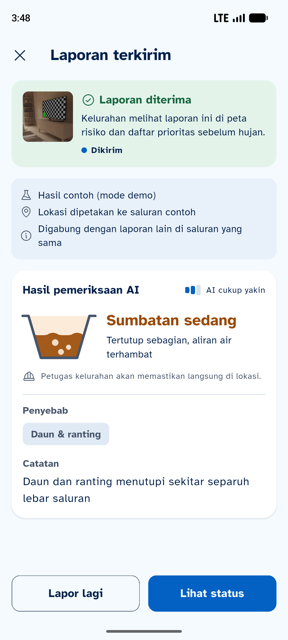
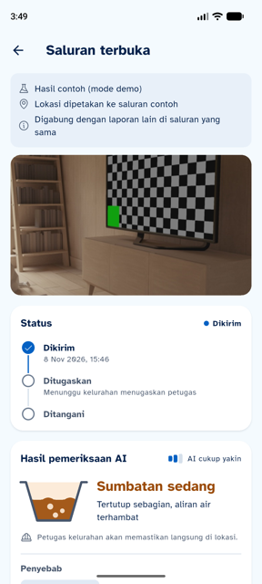

# 10 · Uji Ujung ke Ujung dengan Backend Asli

**Tanggal:** 8 November 2026, 15.30–15.50 · **Branch:** `feature/mobile`
**Backend:** `feature/backend` B lewat tunnel HTTPS (Cloudflare), `DEMO_MODE` aktif, AI `ai_sumber: demo`. Uji terima backend: 17/17 (B).
**Perangkat:** emulator Pixel 8 (arm64), build debug dengan `API_URL=<tunnel>`, `LOKASI_DEMO=true`, `ALLOW_MOCK_LOCATION=true`.

`/health`: `{"ok":true,"demo_mode":true,"ai_siap":true,"db":"ok"}`.

## Hasil

| # | Alur | Endpoint | Hasil |
|---|---|---|---|
| 1 | Masuk petugas `petugas1` | `POST /auth/login` | ✅ Nama "Petugas 1" dari `pengguna.nama`, sesi `role: petugas` |
| 2 | Token notifikasi | `POST /devices` | ✅ Terkirim setelah login (tanpa error di log app) |
| 3 | Notifikasi tugas baru (FCM) | `POST /tasks` (dari B) → FCM `type: tugas_baru` | ✅ Diterima HP 15.33.20 dan 15.37.01; tugas langsung muncul di tab Tugas |
| 4 | Peta risiko | `GET /rw/risk?kelurahan_id=1` | ✅ 6 poligon RW Cisaranten Kidul, warna sesuai level server |
| 5 | Daftar tugas + detail | `GET /tasks?mine=1`, `GET /reports/:laporan_id` | ✅ Catatan lurah ("uji terima", "Tes notifikasi bilah"), status, penanda di peta |
| 6 | Verifikasi tugas saluran 10 (RW 05) dari jarak 116 m | `POST /tasks/3/verify` + `lokasi_demo=true` | ✅ App memberi peringatan "Mode demo: lokasi dipetakan ke saluran contoh" tanpa memblokir; server menerima |
| 7 | Skor RW turun | `GET /rw/risk` sebelum/sesudah | ✅ **RW 05: 0,33 → 0,18** (sumbatan 0,47 → 0,08); tugas 3 `selesai` + foto sesudah tersimpan |
| 8 | Lapor saluran | `POST /reports` + `lokasi_demo=true` | ✅ Hasil AI tampil (sedang), dengan label "Hasil contoh (mode demo)", "Lokasi dipetakan ke saluran contoh", "Digabung dengan laporan lain" |
| 9 | Laporan saya + detail | `GET /reports/:id` | ✅ RW 05 dari server, timeline status, label demo |
| 10 | Lokasi di form | poligon `GET /rw/risk` | ✅ "Di RW 05" |

| Peta dari server | Tinjau (mode demo) | Verifikasi selesai | Hasil lapor | Detail laporan |
|---|---|---|---|---|
|  |  |  |  |  |

## Temuan

| # | Temuan | Pemilik | Tindakan |
|---|---|---|---|
| E1 | Hasil verifikasi menampilkan "Aman → Aman" saat skor turun tapi levelnya tetap | A | Diperbaiki: kalau level sama, hanya satu chip; turunnya terlihat di meteran |
| E2 | `npm run seed` mengosongkan tabel `pengguna`, jadi token FCM ikut terhapus | B | Seed dulu, baru petugas login/buka ulang app (app mengirim ulang token setiap dibuka) |
| E3 | Foto "sebelum" contoh dari seed berupa tangkapan layar halaman Google | B | Ganti dengan foto saluran asli sebelum rekam video |
| E4 | `PATCH /tasks/:id` (Mulai kerjakan) belum ada | B | Untuk demo, lewati "Mulai kerjakan" dan langsung "Foto sesudah" |
| E5 | `ai_sumber` masih `demo` | C | App sudah memberi label demo; setelah AI asli aktif, label hilang sendiri |
| E6 | Kamera menunggu "Mengunci lokasi GPS…" di emulator | – | Bukan bug app: emulator hanya mengirim lokasi saat `geo fix` dikirim. HP asli tidak terpengaruh |

Belum diuji: notifikasi tampil di bilah notifikasi saat app di latar belakang. Pesan FCM 15.37.01 sampai, tapi app ditutup paksa beberapa detik kemudian, dan Android menghapus notifikasi app yang ditutup paksa.

## Checklist sebelum rekam video

1. Kabari B → B menjalankan `npm run seed`.
2. Di HP: buka app → masuk `petugas1` (atau tutup lalu buka app kalau sudah masuk).
3. Pakai APK release `--split-per-abi` dengan `API_URL` tunnel/deploy dan `LOKASI_DEMO=true`.
4. Siapkan APK mode contoh (tanpa `API_URL`) sebagai cadangan kalau server/tunnel bermasalah.
