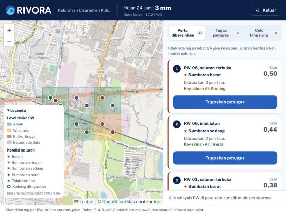
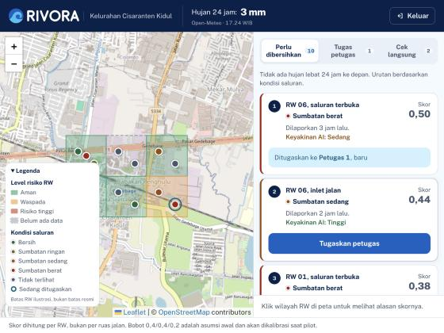
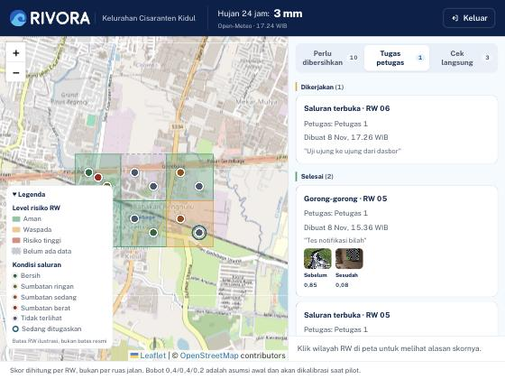
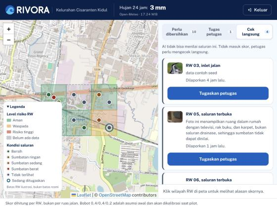
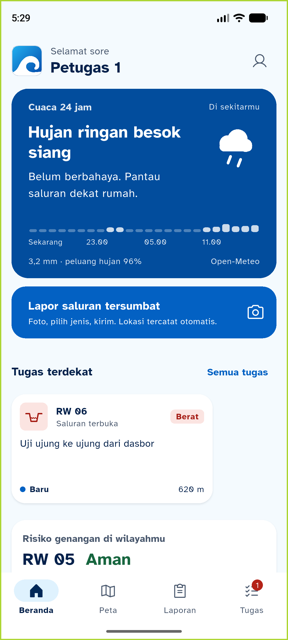
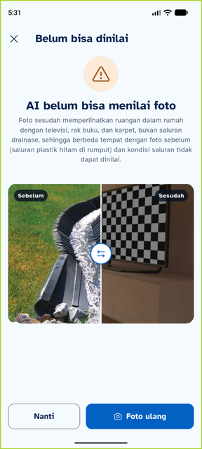
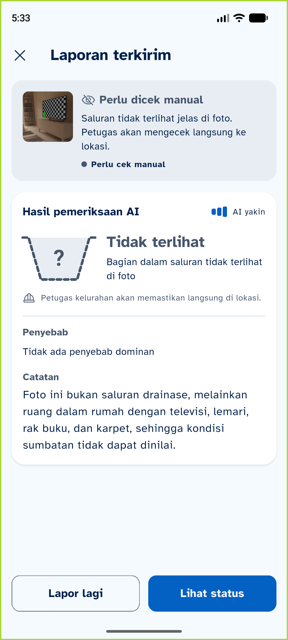
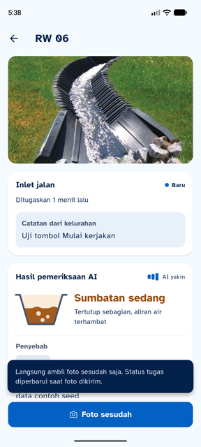
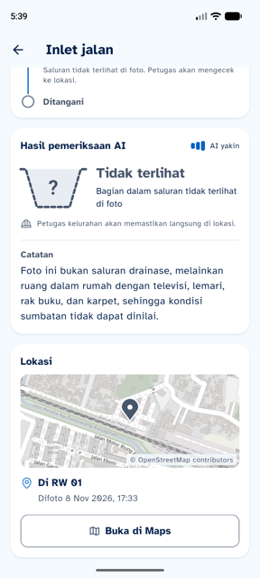

# 11 · Uji Sistem Penuh: Dasbor + Backend + Mobile (branch `dev`)

**Tanggal:** 8 November 2026, 17.20–17.40 · **Yang diuji:** isi `dev` (`fad20d9`, gabungan PR #1–#9)
**Catatan:** `main` di GitHub masih `initial commit`. Semua kerja ada di `dev`.

## Cara uji

| Bagian | Cara |
|---|---|
| Backend | `node backend/src/index.js` lokal (port 3000) memakai `.env` root: database tim (Supabase), AI asli `claude-sonnet-5-5`, **tanpa** `DEMO_MODE`, tanpa service account FCM |
| Dasbor | `npm --prefix dashboard run dev` dengan `dashboard/.env.local`: `VITE_API_URL=http://localhost:3000`, `VITE_USE_MOCK=0`. Diuji di browser bawaan, masuk sebagai `lurah` |
| Mobile | Emulator Pixel 8, `API_URL=http://10.0.2.2:3000` (backend lokal), masuk sebagai `petugas1` |

`npm run seed` sengaja **tidak** dijalankan (database dipakai bersama tim).

## Tes otomatis

| Bagian | Perintah | Hasil |
|---|---|---|
| Backend | `npm test` | ✅ 15/15 |
| Dasbor | `npm run lint` | ⚠️ 0 error, 1 peringatan (`DemoRainSlider.jsx`: setState di dalam effect) |
| Dasbor | `npm run build` | ✅ JS 428 KB (gzip 130 KB), CSS 38 KB |
| Mobile | `flutter analyze` / `flutter test` | ✅ bersih / **58/58** (setelah perbaikan di bawah) |

## Siklus ujung ke ujung

| # | Langkah | Hasil |
|---|---|---|
| 1 | Lurah masuk dasbor | ✅ Kelurahan Cisaranten Kidul, hujan 24 jam 3 mm (Open-Meteo), peta 6 RW + titik saluran, prioritas "Perlu dibersihkan 10 · Tugas petugas 0 · Cek langsung 2". Konsol tanpa error |
| 2 | Lurah menugaskan RW 06 (saluran terbuka, berat) ke Petugas 1 + catatan | ✅ Tugas dibuat. Pesan jujur: "notifikasi tidak terkirim, petugas tetap melihatnya di daftar tugas" (backend lokal tanpa FCM) |
| 3 | HP petugas menerima tugas | ✅ "Tugas terdekat: RW 06 · Uji ujung ke ujung dari dasbor" |
| 4 | Detail tugas | ✅ Foto sebelum (foto saluran asli), catatan lurah, hasil AI laporan asal |
| 5 | Foto sesudah di lokasi (0 m, batas 30 m tanpa mode demo) | ✅ Diterima server |
| 6 | **AI asli menilai foto sesudah** | ✅ AI menolak: foto memperlihatkan ruangan dengan televisi, bukan saluran, dan berbeda tempat dengan foto sebelum. App: "AI belum bisa menilai foto" + alasan AI + Foto ulang |
| 7 | Dasbor setelah verifikasi ditolak | ✅ Tugas pindah ke **Dikerjakan**; antrean **Cek langsung 2 → 3** |
| 8 | Warga/petugas lapor (foto bukan saluran) dengan AI asli | ✅ Status **"Perlu cek manual"**, penampang "?" + catatan AI; dasbor **Cek langsung 3 → 4** |
| 9 | Verifikasi sebelumnya (saluran 10, backend B) di dasbor | ✅ Selesai, foto sebelum/sesudah, skor 0,85 → 0,08 |

| Dasbor: prioritas | Dasbor: sudah ditugaskan | Dasbor: tugas petugas | Dasbor: cek langsung |
|---|---|---|---|
|  |  |  |  |

| HP terima tugas | AI menolak foto | Lapor → cek manual |
|---|---|---|
|  |  |  |

Langkah 6 dan 8 menunjukkan pencegahan laporan palsu (proposal Tabel 8): foto yang bukan saluran tidak bisa menurunkan skor, dan masuk antrean pemeriksaan lurah.

## Temuan dan perbaikan

| # | Temuan | Pemilik | Status |
|---|---|---|---|
| S1 | "Mulai kerjakan" memunculkan pesan teknis "Endpoint tidak ditemukan" karena `PATCH /tasks/:id` belum ada | A (tampilan) / B (endpoint) | ✅ App: kalau server membalas 404/405, tombol disembunyikan dan muncul "Langsung ambil foto sesudah saja. Status tugas diperbarui saat foto dikirim." ⏳ B: tambah `PATCH /tasks/:id` (SRS 7.11, P2) |
| S2 | Kartu AI menampilkan "Penyebab: Tidak ada penyebab dominan" untuk foto yang tidak memperlihatkan saluran | A | ✅ Bagian Penyebab disembunyikan bila `tidak_terlihat` |
| S3 | Dasbor baru menampilkan "Ditugaskan ke Petugas 1" sekitar 10 detik setelah tugas dikirim (menunggu pembaruan berkala) | C | ⏳ Muat ulang daftar langsung setelah `POST /tasks` berhasil |
| S4 | Login dasbor ±5 detik | B | Catatan: bcrypt + koneksi pertama ke database; tidak menghalangi demo |
| S5 | Peringatan lint `react(set-state-in-effect)` di `DemoRainSlider.jsx` | C | Catatan |
| S6 | `main` belum berisi apa pun | Tim | ⏳ PR `dev` → `main` setelah S1 (backend) selesai, atau langsung di checkpoint |

| S1 sesudah | S2 sesudah |
|---|---|
|  |  |

Sudah diuji di [10-uji-backend-asli.md](10-uji-backend-asli.md) (backend B, `DEMO_MODE`): notifikasi FCM ke HP, verifikasi `lokasi_demo` dengan skor RW turun.

## File lokal untuk uji (tidak di-commit)

`.claude/launch.json` (menjalankan backend + dasbor dari app) dan `dashboard/.env.local` (dasbor → backend lokal). Keduanya tidak perlu masuk repo.
