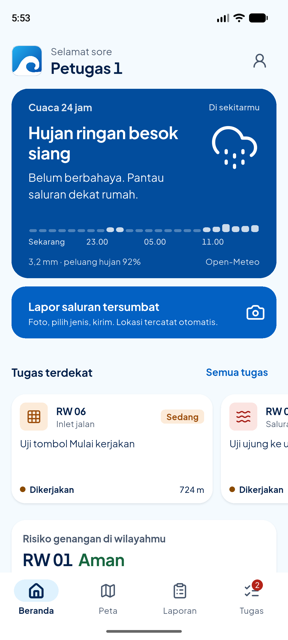
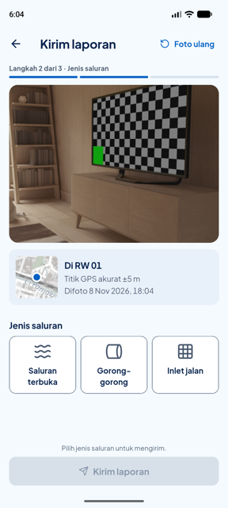
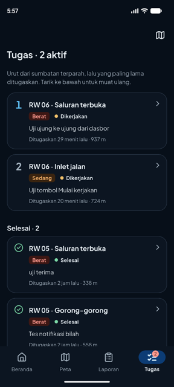
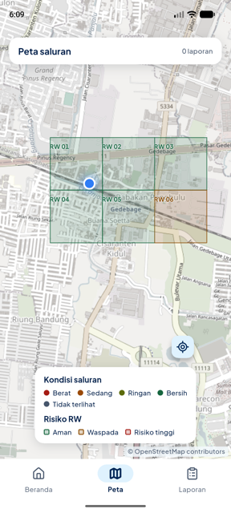

# 12 · Ikon Lucide dan Font Plus Jakarta Sans

**Tanggal:** 8 November 2026 · **Branch:** `feature/mobile`
**Permintaan:** ganti ikon ke library Flutter lain, dan ganti font (angka 0 bergaris miring di Atkinson Hyperlegible dinilai jelek).

## Keputusan dan referensi

| Bagian | Sebelum | Sesudah | Alasan |
|---|---|---|---|
| Ikon | Phosphor (font yang dipasang manual) + piktogram jenis saluran dan cuaca yang digambar sendiri | **Lucide** lewat paket [`lucide_icons_flutter`](https://pub.dev/packages/lucide_icons_flutter) 4.0.2 (ISC), ±1.600 ikon | Satu keluarga untuk semua ikon, garis 2 px di grid 24 px dengan ujung membulat. Pustaka ikon bawaan shadcn/ui. Paket ini memakai `IconData` biasa, jadi bisa dikompilasi di Flutter 3.47 (`phosphor_flutter` tidak bisa, lihat [05](05-audit-qa.md)) |
| Font | Atkinson Hyperlegible | **Plus Jakarta Sans** 2.7.1 (Tokotype, OFL), bobot 400/500/600/700/800 | Dibuat untuk identitas kota Jakarta (+Jakarta City of Collaboration), jadi cocok untuk layanan publik kota di Indonesia. Angka 0 tanpa garis miring, dan punya angka tabular (`tnum`) |

## Ikon

`lib/theme/rivora_icons.dart` (`RIcons`) masih jadi satu-satunya pintu ikon, jadi nama ikon di seluruh layar tidak berubah.

| Pakai | Ikon Lucide |
|---|---|
| Tab (tidak aktif / aktif) | `house`, `map`, `clipboardList`, `listChecks`. Lucide tidak punya versi isi, jadi tab aktif memakai **bobot 600** (`LucideIcons600`); latar indikator Material 3 tetap menandai tab aktif |
| Jenis saluran | Terbuka `waves`, gorong-gorong `cylinder` diputar 90° (jadi pipa mendatar), inlet jalan `grid3x3` |
| Cuaca di kartu hujan | `sun`, `cloudDrizzle`, `cloudRain`, `cloudLightning` dengan **bobot 300** supaya tidak berat di ukuran 72 px |
| Faktor risiko | Hujan `cloudRain`, sumbatan `trash2`, daerah tergenang `wavesArrowUp` (air naik) |
| Lainnya | `camera`, `send`, `navigation`, `badgeCheck`, `brushCleaning`, `locateFixed`, `sparkles`, `hardHat`, `triangleAlert`, `circleCheck`, `eyeOff`, `cloudOff`, `flaskConical`, dll. |

Piktogram buatan sendiri (`CustomPainter`) di `pictogram.dart` dan `rain_card.dart` dihapus. Ukurannya disesuaikan dengan garis Lucide: kartu tugas 22, form 32, placeholder foto 44/28.

## Font

- `pubspec.yaml`: keluarga `PlusJakartaSans` (5 bobot). Atkinson Hyperlegible dan Phosphor dihapus dari aset.
- `app_theme.dart`: semua gaya teks memakai `FontFeature.tabularFigures()`, jadi skor, jam, jarak, dan jumlah tidak bergeser saat berubah. Jarak huruf: judul besar dirapatkan (−1 sampai −0,2), teks isi 0, label kecil +0,1 sampai +0,3.
- Paket `cupertino_icons` yang tidak dipakai ikut dihapus (−116 KB di APK).

## Peta RW: tetap poligon

Area RW sempat dicoba sebagai lingkaran radius bergradasi (commit `9641613`). Setelah dilihat di HP hasilnya terasa aneh, jadi dikembalikan ke poligon batas wilayah seperti sebelumnya (`rw_risk.dart`, `rivora_map.dart`, `map_screen.dart` sama dengan sebelum `9641613`). Tes lingkaran di `tahap12_test.dart` ikut dihapus.

## Hasil uji

| Uji | Hasil |
|---|---|
| `flutter analyze` | **No issues found** |
| `flutter test` | **62/62 lulus** (+4 di `test/tahap12_test.dart`: ikon satu keluarga Lucide + bobot, ikon cuaca per kategori, gorong-gorong diputar, font + angka tabular) |
| Emulator Pixel 8, backend lokal | Beranda, peta, daftar tugas, detail tugas, kamera, form lapor, Laporan saya: light dan dark. Peta poligon dicek ulang setelah dikembalikan |
| APK release arm64 (`--split-per-abi`) | **21,9 MB** (doc 09: 19,9 MB, sebelum FCM ditambahkan) |

Catatan ukuran: paket Lucide mendaftarkan 7 file font. Font yang dipakai (reguler, 300, 600) dipangkas otomatis jadi 2–17 KB, tapi 4 bobot yang tidak dipakai (100, 200, 400, 500) ikut terbawa utuh, ±0,95 MB terkompresi. Kalau ukuran APK jadi masalah, font Lucide bisa dipasang manual seperti Phosphor dulu.

| Beranda (font + ikon cuaca) | Form: ikon jenis saluran | Daftar tugas (gelap) | Peta (poligon, mode warga) |
|---|---|---|---|
|  |  |  |  |

## Catatan emulator

Pukul 18.07 data app di emulator dihapus lewat `adb shell pm clear` (tercatat di log sistem: `am_clear_app_data_caller`). Itu tidak berasal dari perubahan kode ini. Akibatnya sesi `petugas1` dan "Laporan dari HP ini" hilang, jadi app kembali ke mode warga. Untuk uji petugas berikutnya, masuk ulang `petugas1`.
