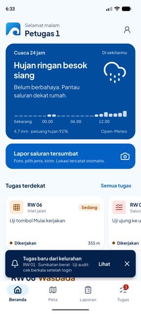
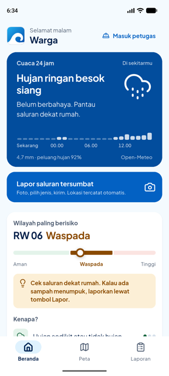

# 13 · Perbaikan Temuan Audit Alur Mobile

**Tanggal:** 8 November 2026 · **Branch:** `feature/mobile`
**Sumber:** audit eksternal (GPT) atas commit `fad20d9`, berisi 10 temuan + batas kesiapan rilis. Setiap temuan dicek ulang ke kode `feature/mobile` sebelum diperbaiki.

## Ringkasan

| # | Temuan audit | Pemilik | Status |
|---|---|---|---|
| 1 | Cek tugas berkala berhenti setelah warga masuk sebagai petugas | A | ✅ Diperbaiki, terbukti di tes dan di emulator |
| 2 | Laporan yang baru dikirim hilang kalau refresh lama selesai belakangan | A | ✅ Diperbaiki |
| 3 | GPS lama (posisi terakhir) diterima sebagai lokasi foto baru | A | ✅ Diperbaiki |
| 4 | Respons tugas sesi lama mengisi lagi daftar setelah keluar; jalur 401 tidak mengosongkan tugas | A | ✅ Diperbaiki |
| 5 | Verifikasi yang ditolak (409) tetap menyimpan data kondisi saluran; tidak ada transaksi | B | ⏳ Backend |
| 6 | Laporan gabungan tidak ikut "ditangani" dan tidak mendapat bukti | B | ⏳ Backend |
| 7 | "Mulai kerjakan" memanggil `PATCH /tasks/:id` yang belum ada | A / B | ✅ App sudah aman sejak `a5412e6` (doc 11; audit memakai commit sebelumnya). ⏳ B: endpoint |
| 8 | Ketuk notifikasi saat daftar masih dimuat tidak membuka detail | A | ✅ Diperbaiki |
| 9 | Foto server tidak dipakai kalau file kamera lokal sudah terhapus | A | ✅ Diperbaiki |
| 10 | Respons 2xx yang rusak dianggap sukses (mis. HTML proxy = "tidak ada tugas") | A | ✅ Diperbaiki |

## Perbaikan

### 1 + 4. Layanan petugas mengikuti sesi (`services/session_services.dart`, baru)

**Penyebab:** saat sesi berganti, `AppShell` dibuat ulang (key = token). Flutter memanggil `initState` shell baru **sebelum** `dispose` shell lama. Shell warga lama lalu memanggil `taskWatcher.stop()` dan `pushService.stop()`, sehingga ikut mematikan layanan yang baru dinyalakan shell petugas.

**Perbaikan:**
- `SessionServices` jadi satu-satunya pemilik daftar tugas, cek berkala, dan push. Ia mendengarkan `sessionStore` (dipasang di `RivoraApp.initState`), bukan siklus hidup widget.
  - Sesi petugas mulai: muat tugas, cek berkala menyala, push mendaftar.
  - Sesi berakhir: cek berkala mati, tugas dikosongkan, token FCM dihapus.
- Langkah push dijalankan berurutan (antrean), jadi stop sesi lama selesai dulu sebelum start sesi baru.
- "Sesi berakhir" mencakup tombol Keluar **dan** 401 dari server. Dulu jalur 401 tidak mengosongkan tugas.
- `TaskRepository` punya penghitung generasi. `clear()` menaikkannya, sehingga respons dari permintaan yang masih berjalan dibuang dan permintaan sesi baru tidak terhalang.
- `AppShell` sekarang hanya menampilkan: berlangganan `tugasMasuk` dan memasang callback notifikasi. Callback hanya dilepas kalau masih milik shell itu.

### 2. Laporan baru tidak tertimpa (`ReportRepository.refresh`)

Hasil `GET /reports/:id` sekarang digabung **per ID** ke daftar terkini, bukan menimpa daftar dengan salinan lama. Laporan yang dikirim selama refresh berjalan tetap ada.

### 3. Lokasi foto harus segar (`LocationService.layak`)

Kalau GPS habis waktu, posisi terakhir hanya dipakai bila umurnya ≤ 2 menit **dan** akurasinya ≤ 50 m. Selain itu muncul "Lokasi belum didapat. Coba pindah ke tempat lebih terbuka." Aturan ini berlaku untuk lapor dan verifikasi, karena keduanya lewat `currentPosition()`. Kamera juga mencatat waktu posisi dari GPS (`Position.timestamp`), bukan waktu diterima app, jadi cek "posisi masih segar" saat memotret memakai umur sebenarnya.

### 8. Ketuk notifikasi

- `TaskRepository.refresh()` mengembalikan permintaan yang sedang berjalan, jadi penangan notifikasi benar-benar menunggu hasilnya. Kalau tugas belum ketemu (refresh dimulai sebelum tugas dibuat), dimuat sekali lagi.
- `PushService` menyimpan ketukan notifikasi yang datang sebelum shell petugas siap (app dibuka dari notifikasi), lalu meneruskannya saat callback dipasang.

### 9. Foto: lokal → server → pengganti (`ReportPhoto`)

Kalau file lokal gagal dibaca, `errorBuilder` beralih ke foto dari URL server sebelum menampilkan pengganti.

### 10. Respons server divalidasi (`HttpApiClient`)

- 2xx yang bukan JSON → `ApiException` "…: respons server tidak sesuai. Coba lagi."
- Setiap operasi yang wajib berisi (login, laporan, daftar tugas, verifikasi, peta risiko) mengubah body lewat `_baca`. Bentuk yang salah (null, tipe salah, field wajib hilang) menjadi `ApiException`, bukan `TypeError` yang lolos dari penanganan layar.
- Body kosong tetap diterima untuk operasi tanpa isi (mis. `POST /devices` 201/204).

## Hasil uji

| Uji | Hasil |
|---|---|
| `flutter analyze` | **No issues found** |
| `flutter test` | **76/76 lulus** (+14 di `test/tahap13_test.dart`) |
| Tes reproduksi audit (`audit_test.dart`) | **4/4 lulus**; sebelum perbaikan 4/4 gagal |
| Tes alur login → cek berkala | Lulus. Dengan baris lama (`taskWatcher.stop()` di dispose shell) dipasang lagi, tes **gagal** (`Expected: true, Actual: false`), jadi tes ini benar-benar menangkap bug #1 |
| Emulator, backend lokal tanpa FCM | Warga → masuk `petugas1` → lurah menugaskan RW 01 dari dasbor 18.32.40 → HP menampilkan "Tugas baru dari kelurahan" ±30 detik kemudian, badge 2 → 3. Karena backend lokal tanpa FCM, tugas hanya bisa sampai lewat cek berkala. Keluar → mode warga, tab Tugas hilang. Masuk lagi → 3 tugas dari sesi baru |

`shell_test.dart` dari audit tetap gagal, tapi karena cara tesnya: login dijalankan di `runAsync` (waktu nyata), sedangkan tes memajukan waktu tiruan, jadi muat tugas tidak sempat selesai sebelum `expect`. Tes pengganti di `tahap13_test.dart` memeriksa langsung bahwa cek berkala masih aktif setelah login.

| Tugas masuk lewat cek berkala setelah login | Keluar → mode warga |
|---|---|
|  |  |

**Data uji di database tim:** satu tugas baru "Uji audit: cek berkala setelah login" (RW 01, saluran terbuka, Petugas 1). Hilang saat B menjalankan `npm run seed` sebelum rekam video.

## Untuk B (backend)

1. **#5 Verifikasi dalam satu transaksi.** Di `routes/tasks.js` (verify): setelah analisis AI, jalankan cek ulang status tugas + insert kondisi + update tugas + update laporan dalam satu transaksi pada koneksi yang sama, dengan `SELECT … FOR UPDATE` pada baris tugas. Rollback semua kalau tugas sudah selesai (409) atau salah satu penulisan gagal. Sekarang kiriman kedua mendapat 409, tapi data kondisinya (berat, 0,85) tetap tersimpan sesudah hasil bersih (0,08).
2. **#6 Laporan gabungan.** Tugas hanya menunjuk laporan terbaru, jadi hanya laporan itu yang jadi "ditangani". Laporan lain di saluran yang sama perlu ikut ditandai dan mendapat bukti dari siklus penanganan yang sama, tanpa ikut menutup laporan yang masuk setelah pembersihan.
3. **#7 `PATCH /tasks/:id`** (`baru` → `dikerjakan`, cek tugas milik petugas itu). App sudah menyembunyikan tombol kalau endpoint membalas 404/405.
4. `npm audit --omit=dev`: 6 paket transitif tingkat sedang (glob/minimatch), 0 high/critical. Belum terbukti bisa dipicu input app.

## Batas kesiapan rilis (belum diubah, keputusan tim)

| Hal | Kondisi | Kenapa belum diubah |
|---|---|---|
| Signing release | Masih kunci debug (`build.gradle.kts`) | Cukup untuk APK demo. Kunci rilis perlu dibuat dan disimpan tim, tidak boleh masuk repo |
| HTTP tanpa TLS | Diizinkan di manifest utama | Uji lokal memakai `http://10.0.2.2:3000`. Untuk pilot: batasi ke build debug dan pakai backend HTTPS |
| `API_URL` kosong = mode contoh | Juga berlaku di release | Disengaja sebagai APK cadangan saat demo (doc 10). Build pilot wajib `API_URL` benar dan tanpa `ALLOW_MOCK_LOCATION` |
| Token di `shared_preferences` | Sesuai SRS | Enkripsi penyimpanan dan backup perangkat belum dinilai |
